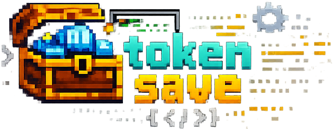
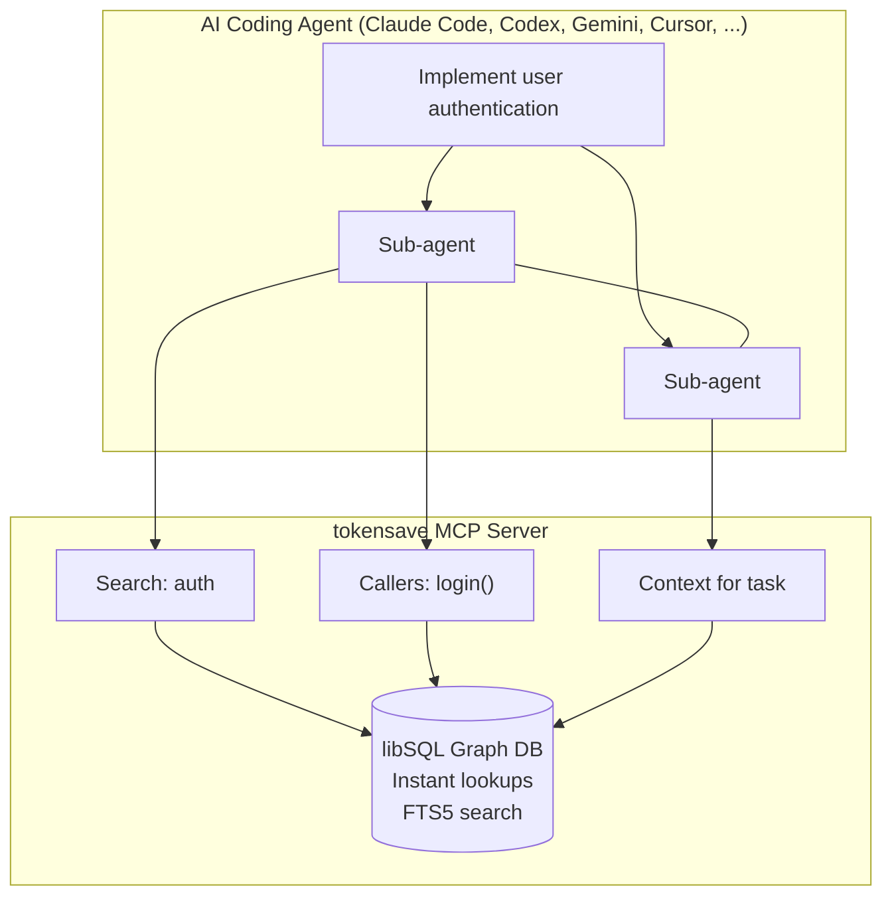
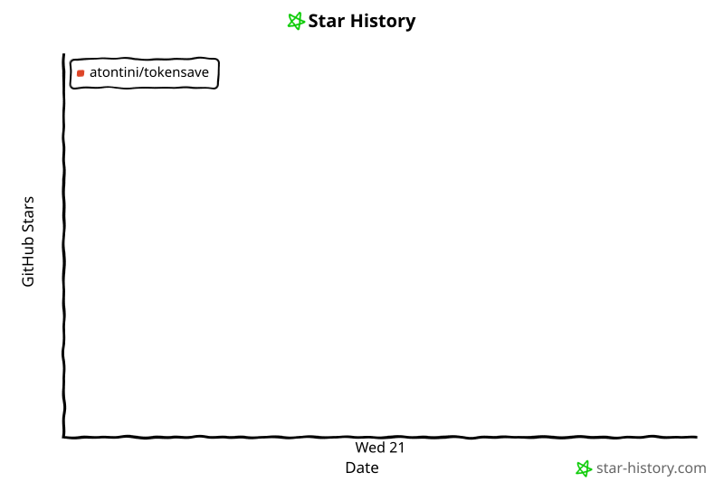
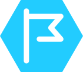

[](https://mcptoplist.com/server/io.github.aovestdipaperino%2Ftokensave)

<p align="center">
  
</p>

<h3 align="center">Semantic Code Intelligence for AI Coding Agents</h3>

<p align="center"><strong>Fewer tokens &bull; Fewer tool calls &bull; 100% local</strong></p>

<p align="center">
  <a href="https://github.com/aovestdipaperino/tokensave/stargazers"></a>
  <a href="https://crates.io/crates/tokensave"></a>
  <a href="https://opensource.org/licenses/MIT"></a>
  <a href="https://www.rust-lang.org/"></a>
  <a href="https://ai.enzolombardi.net/"></a>
</p>

<p align="center">
  
  
  
  <a href="https://hypercommit.com/tokensave"></a>
  <!-- Listing badge only. Deliberately not wrapped in a link: the badge's own
       href points at a monetization page on the marketplace's side (#406). -->
  
</p>

---

> **Beta available:** Try the new, improved queries on the [beta branch](https://github.com/aovestdipaperino/tokensave/tree/beta), including optimized search ranking, graph analysis, and indexing cleanup. See the [beta changelog](https://github.com/aovestdipaperino/tokensave/blob/beta/CHANGELOG.md) for details.
>
> Install from source: `cargo install --git https://github.com/aovestdipaperino/tokensave.git --branch beta --locked --force`
>
> For builds with isolated beta storage, follow the [database compatibility guide](docs/DATABASE-COMPATIBILITY.md) when initializing beta or returning to stable. Existing shared databases are preserved; beta uses a fresh index under `.tokensave/beta/`.

## Why tokensave?

AI coding agents waste tokens exploring codebases. Every grep, glob, and file read costs money. On complex tasks, agents spawn multiple Explore sub-agents that scan hundreds of files just to build context.

**tokensave gives agents a pre-indexed semantic knowledge graph.** Instead of scanning files, the agent queries the graph and gets instant, structured answers -- the right symbols, their relationships, and source code, in one call.

### How It Works



**Without tokensave:** Agents use `grep`, `glob`, and `Read` to scan files -- many API calls, high token usage.

**With tokensave:** Agents query the graph via MCP tools -- instant results, local processing, fewer tokens.

---

## Key Features

| | | |
|---|---|---|
| **Smart Context Building** | **Semantic Search** | **Impact Analysis** |
| One tool call returns everything the agent needs -- entry points, related symbols, and code snippets. | Find code by meaning, not just text. Search for "authentication" and find `login`, `validateToken`, `AuthService`. | Know exactly what breaks before you change it. Trace callers, callees, and the full impact radius of any symbol. |
| **80+ MCP Tools** | **50+ Languages** | **12+ Agent Integrations** |
| From call graph traversal to dead code detection, atomic edit primitives, code-health metrics, test mapping, and complexity analysis. | Rust, Go, Java, Python, TypeScript, C, C++, Swift, Svelte, Astro, and 43 more including WGSL/HLSL/Metal shaders, CUDA/HIP, and Markdown. Three tiers (lite/medium/full) control binary size. | Claude Code, Codex CLI, Gemini CLI, Qwen Code, Kiro, Cursor, OpenCode, Copilot, Cline, Roo Code, Zed, Antigravity, Kilo CLI, Kimi CLI, Mistral Vibe, Grok Build, Factory Droid, OMP, Pi, Plank. |
| **Multi-Branch Indexing (opt-in)** | **100% Local** | **Always Fresh** |
| Optional per-branch databases. Cross-branch diff and search without switching your checkout. | No data leaves your machine. No API keys. No external services. Everything runs on a local libSQL database. | On-demand staleness check on every MCP call (30 s cooldown) plus catch-up sync when the server connects. Multi-agent work is expected to use git worktrees — each agent gets its own checkout and the index diverges are merged by git, not by a file watcher. |
| **Subprocess-Isolated Extraction** | **Code-Health Analytics** | **Atomic Edit Primitives** |
| A native crash in any tree-sitter grammar (abort, segfault, anything) kills only the worker; the pool respawns it and sync continues. Sync never dies on a malformed file. | Composite health score (0-10000), Gini inequality, file-DAG depth, design-structure matrix, risk-weighted test gaps, and session deltas. | Edit files without regex or shell-quoting hazards: unique-anchor `str_replace`, atomic multi-replace, AST-rewrite, anchored insert. Auto re-indexes after writes. |

---

## Quick Start

### 1. Install

Choose one installation method:

| Platform | Command |
|---|---|
| macOS (Homebrew) | `brew install aovestdipaperino/tap/tokensave` |
| Any platform with Rust | `cargo install tokensave` |
| Any platform with cargo-binstall | `cargo binstall tokensave` |

To install the latest code directly from the upstream `master` branch instead of the published crates.io release:

```bash
cargo install --git https://github.com/aovestdipaperino/tokensave.git --branch master --locked --force
```

This builds the current `master` branch from source. It may include changes not yet published in a stable release and requires the Rust toolchain.

On Windows with Scoop:

```powershell
scoop bucket add tokensave https://github.com/aovestdipaperino/scoop-bucket
scoop install tokensave
```

You can also download a [prebuilt binary](https://github.com/aovestdipaperino/tokensave/releases/latest) and add it to your `PATH`.

<details>
<summary>Installation alternatives and language tiers</summary>

The default Cargo build includes all supported languages. For a smaller build:

```bash
cargo install tokensave --no-default-features --features medium
cargo install tokensave --no-default-features    # lite (smallest binary)
```

Prebuilt release archives:

| Platform | Archive |
|---|---|
| macOS (Apple Silicon) | `tokensave-vX.Y.Z-aarch64-macos.tar.gz` |
| Linux (x86_64) | `tokensave-vX.Y.Z-x86_64-linux.tar.gz` |
| Linux (ARM64) | `tokensave-vX.Y.Z-aarch64-linux.tar.gz` |
| Windows (x86_64) | `tokensave-vX.Y.Z-x86_64-windows.zip` |

</details>

### 2. Configure your agent

Run the setup command to auto-detect your installed agents:

```bash
tokensave install
```

To choose an agent, use `--agent` (for example, `codex`, `claude`, or `cursor`):

```bash
tokensave install --agent codex
```

Setup registers the MCP server and the agent's integration for Claude Code,
Codex CLI, Gemini CLI, Cursor, Copilot, Kiro, Pi, Zed, and
[more than a dozen other agents](docs/guide/AGENT-INTEGRATIONS.md#configuring-your-agent).
It also offers global Git hooks to keep initialized projects up to date. You can
safely run setup again after upgrading. See
[Agent Integrations](docs/guide/AGENT-INTEGRATIONS.md) for project-local installs,
several agents at once, and what setup writes for each agent.

### 3. Index your project

```bash
cd /path/to/your/project
tokensave init
```

This creates a `.tokensave/` directory with the knowledge graph database. `init`
is a one-time opt-in per project; after it, `tokensave sync` updates the index
incrementally, and a connected agent keeps it fresh automatically. Commands work
from any subdirectory of the project. See
[Indexing and Freshness](docs/guide/INDEXING.md) for details.

---

## Documentation

The full documentation lives in [`docs/guide/`](docs/guide/README.md) and is
mirrored to the [GitHub Wiki](https://github.com/aovestdipaperino/tokensave/wiki).

| Topic | What it covers |
|---|---|
| [Installation and Upgrades](docs/guide/INSTALLATION.md) | Language tiers, self-upgrade and channels, versioning, building from source |
| [Agent Integrations](docs/guide/AGENT-INTEGRATIONS.md) | Supported agents, project-local setup, what install writes |
| [Indexing and Freshness](docs/guide/INDEXING.md) | Project discovery, index freshness, crash-resilient sync, custom extensions |
| [MCP Tools](docs/guide/MCP-TOOLS.md) | The 80+ tools by category, cross-project queries, MCP resources |
| [Multi-Branch Indexing](docs/guide/MULTI-BRANCH.md) | Per-branch graphs, automatic tracking, branch quality regressions |
| [Token Tracking and Cost](docs/guide/TOKEN-TRACKING.md) | Savings ledger, cost reports, live monitor, memory diagnostics |
| [CLI Reference](docs/guide/CLI-REFERENCE.md) | Every command at a glance |
| [Supported Languages](docs/guide/LANGUAGES.md) | 50+ languages and their feature tiers |
| [Network Calls and Privacy](docs/guide/PRIVACY.md) | What leaves your machine and how to opt out |
| [Troubleshooting](docs/guide/TROUBLESHOOTING.md) | `tokensave doctor` and common problems |
| [Benchmarks](docs/guide/BENCHMARKS.md) | Retrieval-savings and performance benchmarks |
| [Comparisons](docs/guide/COMPARISONS.md) | tokensave compared with CodeGraph and alternatives |

The long-form [User Guide](docs/USER-GUIDE.md) walks through everyday use in more
depth. To contribute, see [CONTRIBUTING.md](CONTRIBUTING.md).

---

## Origin

This project is a Rust port of the original [CodeGraph](https://github.com/colbymchenry/codegraph) TypeScript implementation by [@colbymchenry](https://github.com/colbymchenry). The port maintains the same architecture and MCP tool interface while leveraging Rust for performance and native tree-sitter bindings.

---

## Building

To build from source, see
[Building from source](docs/guide/INSTALLATION.md#building-from-source) and
[CONTRIBUTING.md](CONTRIBUTING.md).

## Star History

<!-- Chart is rendered in CI by .github/workflows/star-history.yml (the hosted
     star-history.com embed broke with GitHub's 2026-06-30 stargazers API
     restriction). The action rewrites everything between these markers. -->
<!-- star-history:start -->
<picture>
  <source media="(prefers-color-scheme: dark)" srcset="assets/star-history/star-history-dark.svg">
  
</picture>
<!-- star-history:end -->

## Sponsors

<table>
  <tr>
    <td width="64" align="center" valign="middle">
      
    </td>
    <td valign="middle">
      Free code signing on Windows provided by <a href="https://signpath.io">SignPath.io</a>, certificate by <a href="https://signpath.org">SignPath Foundation</a>
    </td>
  </tr>
</table>

## License

MIT License -- see [LICENSE](LICENSE) for details.

**[tokensave.dev](https://tokensave.dev)**
