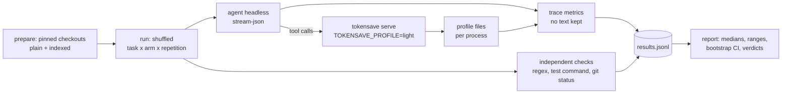

# Agent workflow benchmark

Status: harness implemented; one 63-trial pilot (Refs #948). This page holds the
methodology and the decision report. The harness and its usage are in
[`scripts/agent-bench/`](../scripts/agent-bench/README.md).

## Question

#904 asked whether faster local database queries make agent tasks faster
when model inference and tool-use decisions dominate the elapsed time. This
benchmark answers it at the task level. It measures correctness, wall time,
model turns, tool calls, tokens and cost for the same agent and model with
and without TokenSave. Optimizations are ranked by measured end-to-end
benefit, never by the slowest single query.

Related work, not duplicated here:

- #754 owns profiling inside TokenSave. The harness only reads its
  aggregates ([PROFILING.md](PROFILING.md)) and adds no instrumentation.
- #904 compared libSQL and Grafeo at the storage level. A Grafeo arm is
  possible (see below) but not defined yet.
- #832 (Pi-specific retrieval guidance) stays closed. This harness uses
  Claude Code and changes no agent integration.

## Method

- **Arms.** `baseline`: no MCP server, unindexed checkout. `tokensave`: the
  TokenSave MCP server on an indexed checkout, with only its server
  instructions. `tokensave-guided`: as `tokensave`, plus the rules text that
  `tokensave install` writes for Claude Code. The last two form the guidance
  A/B experiment: the only difference is the guidance text.
- **Isolation.** `--strict-mcp-config` and `--setting-sources project` keep
  the user's MCP servers, hooks, plugins and user instructions out. Agent
  instruction files are removed from the checkouts, so every arm starts
  from the same instructions.
- **Pinning.** The `tokensave` repository at
  `251a0550af0fb89c4fdb3a873bbd002871333eea`, plus a bundled fixture
  project with one seeded bug. Each trial records the agent version,
  requested and reported model, TokenSave version and binary SHA-256, the
  harness commit, OS, architecture and CPU count.
- **Trials.** Every (task, arm, repetition) runs in a seeded random order,
  from a `git reset --hard` snapshot. `--warmup` adds one discarded trial
  per task and arm. Each trial starts a new agent and MCP server process;
  the index is prebuilt.
- **Correctness.** Checked by the harness, not the agent: expected
  identifiers in the answer, a test command, protected files unchanged, no
  edits on read-only tasks.
- **Timing.** Wall time is partitioned exactly into startup, model wait,
  tool wait and tail. Model wait is the observable round trip, not provider
  inference time. TokenSave MCP and database time (#754) are subsets of tool
  wait and are never added to wall time. Summed per-tool wait is reported
  apart, because parallel calls overlap.
- **Repeated retrieval.** Exact duplicates (same tool and arguments, no
  file change in between), revalidations (the same after a change, which is
  legitimate) and near duplicates (same normalized query, other arguments
  changed) are counted from keyed hashes. No argument text is kept.
- **Privacy.** Results hold metrics only. Full traces need `--keep-raw`.
  Nothing is uploaded.

The task suite covers symbol definition, references, impact analysis,
multi-hop retrieval, missing information, a file added after indexing, and a
patch verified by tests. The task table is in the
[harness README](../scripts/agent-bench/README.md#tasks).

## Decision rules

The report assigns each arm and task a dominant actionable bottleneck, in
this order:

1. Lower success rate than baseline: **response/context quality**.
   Speed never outranks correctness.
2. Database time of at least 10% of wall time: **database latency**.
   Only then do engine or query changes (#904) rank first.
3. Exact plus near duplicates of at least 20% of TokenSave calls:
   **number of calls**. Candidates are request caching or batching.
4. Model wait of at least 50% of wall time: **agent/model overhead**.
   TokenSave can act here only through fewer or smaller responses, which
   must be shown to cut model calls or tokens without losing correctness.
5. Otherwise, no single dominant bottleneck.

The thresholds are a starting point. Revisit them when the data supports a
better split.

## Results

### Pilot, 2026-11-10 (Claude Haiku, Windows)

A small pilot, run to validate the harness and get first numbers. It is
not enough to rank optimizations on its own; see the limitations below.

| Condition | Value |
|---|---|
| Agent | Claude Code 2.1.302, headless (`-p`, stream-json) |
| Model | `claude-haiku-5-5` (requested and reported), default effort |
| TokenSave | 7.17.0, release build of `251a0550`, libSQL, profiling `light` |
| Harness | this change, before commit (the records show the base commit) |
| Machine | Windows 11, x86-64, 8 CPUs |
| Design | 7 tasks x 3 arms x 3 repetitions = 63 trials, seed 948, no warmup, budget 0.5 USD per trial |
| Isolation | preflight verified: no user or project instructions loaded |
| Spend | 0.18 USD in total, as estimated by the agent |

Raw aggregate records: [`agent-bench/pilot-2026-11-10-haiku.jsonl`](agent-bench/pilot-2026-11-10-haiku.jsonl)
(metrics only). Generated report with per-task tables and bootstrap
intervals: [`agent-bench/pilot-2026-11-10-haiku.md`](agent-bench/pilot-2026-11-10-haiku.md).

| Arm | Success | Wall p50 (s) | Wall p90 (s) | TokenSave calls p50 | Input tokens p50 (incl. cache) | Output tokens p50 | Startup | Model wait | Tool wait | TokenSave MCP | Database |
|---|---:|---:|---:|---:|---:|---:|---:|---:|---:|---:|---:|
| baseline | 21/21 | 27.4 | 47.0 | 0 | 61,471 | 978 | 25% | 62% | 9% | n/a | n/a |
| tokensave | 21/21 | 30.8 | 75.4 | 1 | 70,833 | 778 | 29% | 51% | 15% | 6% | 0% |
| tokensave-guided | 21/21 | 33.9 | 61.1 | 2 | 74,214 | 582 | 28% | 47% | 22% | 8% | 1% |

Shares are of total wall time. Startup, model wait, tool wait and the
final tail add up to 100%. The TokenSave MCP and database columns are
shares of the same wall time, measured by the #754 profiler, and are part
of tool wait.

TokenSave internals, summed over the 30 trials that made at least one
TokenSave call (108 s of MCP time in total):

| Phase | Time | Share of MCP time |
|---|---:|---:|
| Project resolution (branch lease) | 32.5 s | 30% |
| Freshness check | 8.5 s | 8% |
| Handler | 17.2 s | 16% |
| ... of which database | 7.0 s | 6.5% |
| Not covered by any profiled phase | 49.7 s | 46% |

A least-squares fit over those 30 trials gives MCP time of about
**2.5 s per trial plus 0.49 s per call**. In the 15 trials with exactly one
TokenSave call, that call took 2.1 s (median), but its handler took 41 ms
and its database work 16 ms. Every trial starts a new server, so the first
call pays a cold-start cost that the profiler's phases do not explain.

### Answers to the questions in #948

1. **Where does the time go?** Model wait is the largest part in every arm
   (47–62% of wall time). Agent startup is next (25–29%, about 5 s per
   trial before the first model call). Tool wait is 9–22%. TokenSave's own
   MCP time is 6–8% of wall time, and its database time 0–1%.
2. **How many calls, and are they avoidable?** The median trial made 3 tool
   calls and 3 model calls (4 agent turns) in every arm. Exact duplicates: 0 in all 63
   trials. Revalidations: 0. Near duplicates (same query, other arguments
   changed): 2 in baseline, 0 in `tokensave`, 4 of 57 TokenSave calls in
   `tokensave-guided`. Redundant retrieval is not a bottleneck here.
3. **Do smaller, better-ranked responses reduce model calls and tokens?**
   Not shown. TokenSave arms produced fewer output tokens (778 and 582
   against 978 at the median) but used 15–21% more input tokens, at an
   equal median cost (0.002 USD). TokenSave responses are small (median
   below 1k estimated tokens per trial). A likely source of the extra input
   is the MCP tool definitions and server instructions carried in every
   turn, but the pilot did not measure that separately.
4. **Slow queries or cumulative query counts?** Neither. Database time was
   7 s out of 1,688 s of wall time in the TokenSave arms. The cost that
   matters inside TokenSave is fixed per-call and first-call overhead
   outside the handler.
5. **Would a different database backend change task time?** No measurable
   effect is possible on this workload: an instant database would save
   0.4% of wall time in the TokenSave arms (0.6% counting only trials that
   called TokenSave). Grafeo (#904) was not run (see
   [harness README](../scripts/agent-bench/README.md#what-is-compared)).

### Guidance A/B (`tokensave` against `tokensave-guided`)

The one optimization hypothesis tested: does the rules text that `tokensave
install` writes improve the workflow? It made the agent use TokenSave more
(median 2 calls against 1; 9 against 3 in `multi-hop`, with 208k against
168k input tokens). Correctness did not change (21/21 in both arms), and wall
time did not improve (median 33.9 s against 30.8 s; most per-task 95%
intervals include zero). **Not supported:** on this suite, stronger guidance
increased tool use without improving speed or correctness.

### Per-task signals

- `definition` and `callers`: `tokensave` had a lower median than baseline
  (−6.2 s and −4.6 s), but the 95% intervals include zero.
- `missing-symbol`: `tokensave` was slower (+17.4 s, interval +14.8 to
  +66.2 s). Baseline agents settled it with a single grep. The TokenSave
  MCP call accounts for 2.8 s of the difference (median); the rest is
  model and startup time that this pilot does not explain.
- `multi-hop`: the TokenSave arms were slower at the median (+14.6 s and
  +34.9 s; intervals include zero) and used more input tokens.
- `bugfix` and `impact`: the agents rarely called TokenSave at all.

### Dominant actionable bottleneck

| Workload | Verdict |
|---|---|
| All tasks, `tokensave` | Agent/model overhead (51% of wall time). TokenSave internals are 6%; database latency is not actionable. |
| All tasks, `tokensave-guided` | No single dominant bottleneck; more TokenSave calls without a gain. |
| `missing-symbol` | Slower with TokenSave; its first-call cost (about 2.8 s) explains only part of it. |

### Tool-contract friction

7 of the 81 TokenSave calls in the pilot failed before producing a result:

- 4 `tokensave_search` calls were rejected by the agent as invalid JSON:
  the model wrote the array argument `path_include` as a bare, unquoted
  string (`"path_include": src/profile`).
- 1 `tokensave_context` call was rejected as invalid JSON for a reason the
  trace does not show.
- 2 `tokensave_read` calls used `file_path`, the name of the agent's own
  Read argument, instead of `file`/`path`.

In the invalidated run described below, which used `tokensave_read` more
often, the same `tokensave_read` error occurred 8 times in 18 calls.

### Invalidated first run

A first pilot passed `--setting-sources project`. The harness's own
analysis showed baseline agents searching for `mcp__tokensave__*` tools as
their first action, and a direct probe confirmed that the user's
`~/.claude/rules/tokensave.md` was still loaded. That run gave every arm,
including the baseline, the TokenSave rules. It was stopped after 49 trials
and discarded. The harness now uses `--setting-sources ""`, scrubs the
calling session's environment, and refuses to run unless a preflight
shows no instruction files are loaded.

### Limitations of the pilot

- One model (Haiku), one machine (Windows), three repetitions per cell, no
  warmup. Most per-task differences are inside their 95% intervals.
- All 63 trials passed, so the suite does not yet separate the arms on
  correctness. Harder tasks are needed before ranking by success.
- Every trial starts a new MCP server, which weights the cold first call
  heavily. Long agent sessions amortize it.
- The profiler leaves 46% of MCP time unattributed, so its cause is a
  hypothesis, not a measurement.
- The agent's cost figure is its own estimate at built-in rates.

### Proposed follow-ups (supported by this pilot)

These are proposals for separate issues. None is implemented here.

1. **Cold first MCP call.** Measure and reduce the roughly 2 s first-call
   cost, and extend the #754 phases to cover the 46% of MCP time they
   miss. Supported by the 2.5 s fixed-cost fit and the single-call trials.
2. **Tool argument tolerance.** Consider accepting `file_path` as an alias in
   `tokensave_read`, and a single string where `path_include` and
   `path_exclude` take arrays. Re-run the benchmark to check the error count
   falls without other changes.
3. **Benchmark coverage.** Add harder tasks, a larger model, Linux, at least
   ten repetitions and `--warmup`, so p90 and correctness differences become
   measurable.

Not proposed: database or engine work for agent latency (point 5 above),
request caching or deduplication (no exact duplicates were found), and
stronger agent guidance (the guidance A/B).
