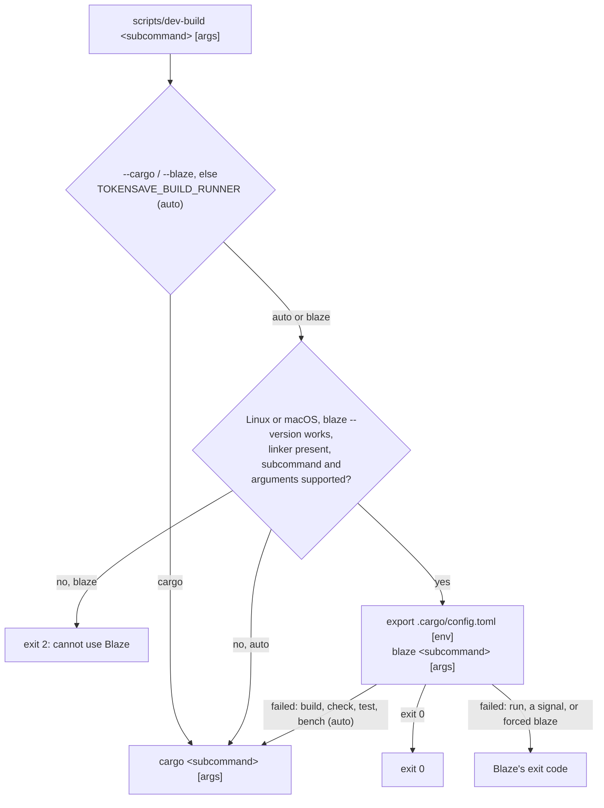

# Blaze as an optional local runner (#984)

[Blaze](https://github.com/indexable-inc/blaze) is an alternative Rust build
system that keeps a project compiled in a background daemon and rebuilds only
the functions an edit changed. This document records how TokenSave uses it
for local development, what was found when it was tried, and how to measure
it against Cargo.

**Status: draft.** The runner and the benchmark harness are implemented and
tested. The compatibility findings below are from one Linux machine. The
TokenSave build and test timings are still being collected and will be added
to [Measurements](#measurements).

## Scope

- **In scope:** local builds and tests on a developer's own Linux or macOS
  machine, when Blaze is installed and usable.
- **Out of scope:** CI, release builds, and any required tooling. Cargo
  remains the authoritative build, validation and release path, and Blaze is
  never a dependency. Windows uses Cargo.

## Setup

Blaze is optional. To try it on Linux (glibc 2.34+, x86-64 or ARM64) or macOS
on Apple silicon:

```sh
curl -fsSL https://ix.dev/blaze | sh       # installs into ~/.cargo/bin
```

The installer verifies the release's SHA-256 sums and downloads Blaze's own
Rust nightly (about 160 MB) into `~/.blaze`. Read the script before running
it if you prefer: it is short, needs no root and asks nothing.

Blaze also needs:

- a C compiler for linking: `cc`/`gcc` on Linux (`build-essential` on Ubuntu),
  Apple's command line tools on macOS;
- what TokenSave's own Linux build needs: `pkg-config` and the OpenSSL
  headers (`libssl-dev`), for `openssl-sys` through `ureq` and `native-tls`;
- memory: its daemon holds a few GB for a small project.

Blaze builds with its own nightly toolchain whatever `rust-toolchain.toml`
pins, so a Blaze build is not a build with the pinned 1.100.0 toolchain.
That is one more reason the plain `cargo` commands stay the final check.

## Local runner

`scripts/dev-build` takes a Cargo subcommand and its arguments and runs them
with Blaze or Cargo:

```sh
scripts/dev-build test --workspace --locked
scripts/dev-build build --locked --no-default-features --features lite
scripts/dev-build --cargo test --workspace --locked   # always Cargo
```



Selection, from highest precedence:

1. `--cargo` or `--blaze` as the first argument.
2. `TOKENSAVE_BUILD_RUNNER`: `auto` (default), `cargo` or `blaze`. Any other
   value is an error (exit 2).

In `auto` mode, Blaze runs only when all of these hold; otherwise Cargo runs,
and a `dev-build:` line on stderr says why:

- The OS is Linux or macOS. Windows (including Git Bash, MSYS2 and Cygwin)
  always uses Cargo.
- `blaze` is on `PATH` and `blaze --version` succeeds.
- The linker is present: `cc` on Linux, Apple's command line tools on macOS.
- The subcommand is one Blaze answers: `build`, `check`, `test`, `run` or
  `bench`.
- No argument names something Blaze does not build yet; see
  [Cases that use Cargo](#cases-that-use-cargo).

When Blaze fails a `build`, `check`, `test` or `bench` in `auto` mode, the
same command runs again with Cargo, and Cargo's exit code is the result. A
`run` is not repeated, because the program may have side effects. A command
stopped by a signal (exit code above 128, such as Ctrl-C) is not repeated
either. With `--blaze` or `TOKENSAVE_BUILD_RUNNER=blaze`, Blaze's result is
final and nothing falls back.

Before it runs Blaze, the runner exports the `[env]` table of
`.cargo/config.toml` as Cargo applies it: a `force = false` entry only when the
variable is unset. Blaze 0.20261027.0 applies that table itself. The runner
exports it anyway because it carries the test isolation that keeps the suite
away from the developer's own agent configuration and git hooks (#575, #381,
#919), and that protection should not depend on Blaze's Cargo compatibility.

The command's own output and exit code pass through unchanged. The runner's
messages go to stderr with a `dev-build:` prefix.

### Cases that use Cargo

Blaze 0.20261027.0 refuses these, so the runner sends them to Cargo:

- subcommands other than `build`, `check`, `test`, `run` and `bench` (for
  example `clippy`, `fmt`, `doc`, `install`);
- `--all-targets`, `--bins`, `--tests`, `--examples`, `--benches`,
  `--target-dir`, `--message-format`, `-Z`, `--build-plan`, `--unit-graph`
  and `--doc`;
- more than one `--test` or more than one `--target`.

Arguments after `--` go to the test binary or program and are not inspected.

## Compatibility findings

Recorded on 2026-11-13 under WSL 2 (Ubuntu 26.04, kernel 6.18, 8 CPUs,
11.7 GiB RAM, ext4), against TokenSave `57a92b2`.

| Release | Finding |
|---|---|
| 0.20261027.0 (stable) | Installs and runs. Applies `.cargo/config.toml` `[env]` to the program, to `env!`/`option_env!` at compile time, and to build scripts, as Cargo does (probe crate). |
| 0.20261027.0 (stable) | **Cannot build any libtest test harness.** On a one-test probe crate, `blaze test` fails with `test::test_main_inner: unsupported: callee add_spawn_hook ... writable static __RUST_STD_INTERNAL_VAL without a rustc symbol`. Every TokenSave test target uses libtest, so `blaze test` cannot run TokenSave's tests on this release, and the runner falls back to Cargo for every test command. |
| 0.20261105.4 (canary, v2) | Does not build on ext4. Its store clones files with reflinks and refuses to copy instead (`cannot share blocks ... Operation not supported (os error 95); blaze does not copy instead`). It needs a file system with reflinks, such as Btrfs or XFS; the default WSL and most Ubuntu installs use ext4. |
| any | No Windows installer. Upstream [indexable-inc/blaze#2078](https://github.com/indexable-inc/blaze/pull/2078) proposes a Windows release archive and PowerShell installer; it is open and unmerged. Blaze's documentation states that v2 has not been run on Windows. |

## Measurements

`scripts/blaze-bench/blaze_bench.py` compares the two tools on a cold build, a
no-op build, five one-function edit rebuilds, and the `sync` subset of the
integration tests with and without an edit. It records wall time, CPU time
(including the Blaze daemon's), peak memory and disk use. See
[its README](../scripts/blaze-bench/README.md) for the method and options.

Results for TokenSave `57a92b2` with the `lite` features are pending. The
first run failed before any comparison because the machine lacked
`pkg-config` and `libssl-dev` (see [Setup](#setup)), and the measured run is in
progress.

## Limitations

- Measured on one WSL 2 machine only. macOS and native Linux have not been
  tried; the runner's macOS path is covered by tests with stub programs only.
- The runner's fallback costs a failed Blaze attempt before Cargo runs. With
  Blaze 0.20261027.0 that happens for every `test` command (see above).
- Blaze builds with its own nightly, not the pinned toolchain, and its
  diagnostics are worded differently from rustc's.
- A Blaze daemon keeps running after a command (it exits after 30 minutes
  idle by default) and holds several GB. `blaze stop` ends it.
- The runner tests (`python3 -B -m unittest discover -s scripts/blaze-bench -p
  'test_*.py'`) are POSIX only and are not part of CI, which this change does
  not modify.
