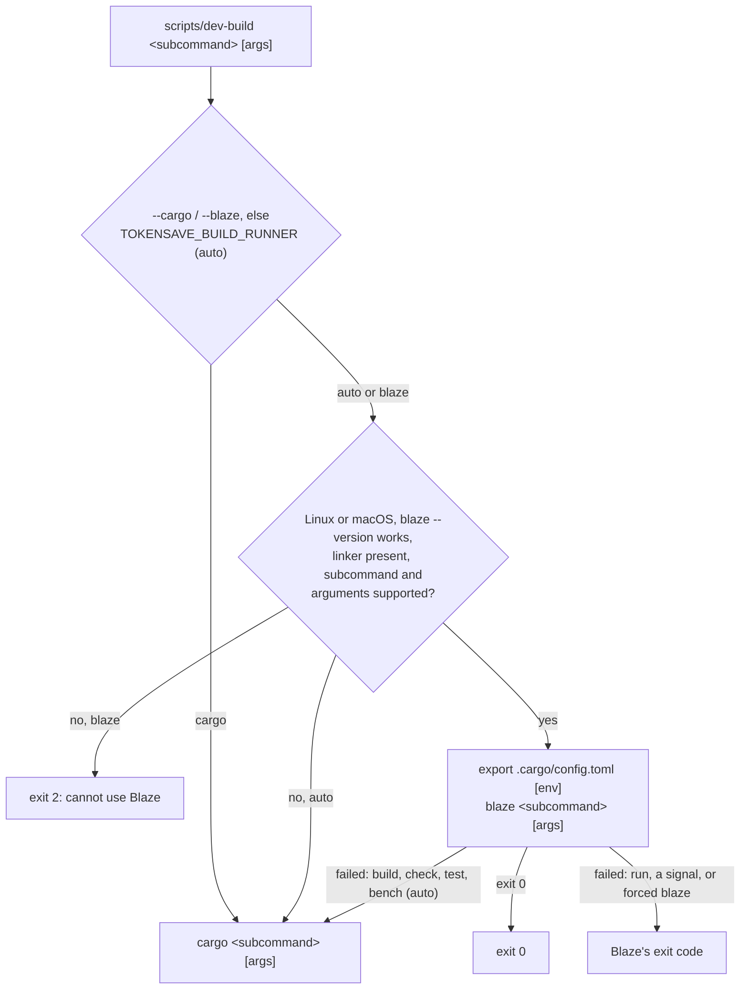

# Blaze as an optional local runner (#984)

[Blaze](https://github.com/indexable-inc/blaze) is an alternative Rust build
system that keeps a project compiled in a background daemon and rebuilds only
the functions an edit changed. This document records how TokenSave uses it
for local development, what was found when it was tried, and how to measure
it against Cargo.

**Implementation:** [PR #990](https://github.com/aovestdipaperino/tokensave/pull/990),
[issue #984](https://github.com/aovestdipaperino/tokensave/issues/984), targeting
`master`. The PR is open and unmerged; no release is implied. The local runner
and benchmark harness are implemented. Linux measurements and remaining
platform limitations are recorded below. CI and release workflows use Cargo.

## Scope

- **In scope:** local builds and tests on a developer's own Linux or macOS
  machine, when Blaze is installed and usable.
- **Out of scope:** CI, release builds, and any required tooling. Cargo
  remains the authoritative build, validation and release path, and Blaze is
  never a dependency. Windows uses Cargo.

## Setup

Blaze is optional. To try it on Linux (glibc 2.34+, x86-64 or ARM64) or macOS
on Apple silicon:

```sh
curl -fsSL https://ix.dev/blaze | sh       # installs into ~/.cargo/bin
```

The installer verifies the release's SHA-256 sums and downloads Blaze's own
Rust nightly (about 160 MB) into `~/.blaze`. Read the script before running
it if you prefer: it is short, needs no root and asks nothing.

Blaze also needs:

- a C compiler for linking: `cc`/`gcc` on Linux (`build-essential` on Ubuntu),
  Apple's command line tools on macOS;
- what TokenSave's own Linux build needs: `pkg-config` and the OpenSSL
  headers (`libssl-dev`), for `openssl-sys` through `ureq` and `native-tls`;
- memory: its daemon holds a few GB for a small project.

Blaze builds with its own nightly toolchain whatever `rust-toolchain.toml`
pins, so a Blaze build is not a build with the pinned 1.100.0 toolchain.
That is one more reason the plain `cargo` commands stay the final check.

## Local runner

`scripts/dev-build` takes a Cargo subcommand and its arguments and runs them
with Blaze or Cargo:

```sh
scripts/dev-build test --workspace --locked
scripts/dev-build build --locked --no-default-features --features lite
scripts/dev-build --cargo test --workspace --locked   # always Cargo
```



Selection, from highest precedence:

1. `--cargo` or `--blaze` as the first argument.
2. `TOKENSAVE_BUILD_RUNNER`: `auto` (default), `cargo` or `blaze`. Any other
   value is an error (exit 2).

In `auto` mode, Blaze runs only when all of these hold; otherwise Cargo runs,
and a `dev-build:` line on stderr says why:

- The OS is Linux or macOS. Windows (including Git Bash, MSYS2 and Cygwin)
  always uses Cargo.
- `blaze` is on `PATH` and `blaze --version` succeeds.
- The linker is present: `cc` on Linux, Apple's command line tools on macOS.
- The subcommand is one Blaze answers: `build`, `check`, `test`, `run` or
  `bench`.
- No argument names something Blaze does not build yet; see
  [Cases that use Cargo](#cases-that-use-cargo).

When Blaze fails a `build`, `check`, `test` or `bench` in `auto` mode, the
same command runs again with Cargo, and Cargo's exit code is the result. A
`run` is not repeated, because the program may have side effects. A command
stopped by a signal (exit code above 128, such as Ctrl-C) is not repeated
either. With `--blaze` or `TOKENSAVE_BUILD_RUNNER=blaze`, Blaze's result is
final and nothing falls back.

Before it runs Blaze, the runner exports the `[env]` table of
`.cargo/config.toml` as Cargo applies it: a `force = false` entry only when the
variable is unset. Blaze 0.20261027.0 applies that table itself. The runner
exports it anyway because it carries the test isolation that keeps the suite
away from the developer's own agent configuration and git hooks (#575, #381,
#919), and that protection should not depend on Blaze's Cargo compatibility.

The command's own output and exit code pass through unchanged. The runner's
messages go to stderr with a `dev-build:` prefix.

### Cases that use Cargo

Blaze 0.20261027.0 refuses these, so the runner sends them to Cargo:

- subcommands other than `build`, `check`, `test`, `run` and `bench` (for
  example `clippy`, `fmt`, `doc`, `install`);
- `--all-targets`, `--bins`, `--tests`, `--examples`, `--benches`,
  `--target-dir`, `--message-format`, `-Z`, `--build-plan`, `--unit-graph`
  and `--doc`;
- more than one `--test` or more than one `--target`.

Arguments after `--` go to the test binary or program and are not inspected.

## Compatibility findings

Recorded on 2026-11-13 under WSL 2 (Ubuntu 26.04, kernel 6.18, 8 CPUs,
11.7 GiB RAM, ext4), against TokenSave `57a92b2`.

| Release | Finding |
|---|---|
| 0.20261027.0 (stable) | Installs and runs. Applies `.cargo/config.toml` `[env]` to the program, to `env!`/`option_env!` at compile time, and to build scripts, as Cargo does (probe crate). |
| 0.20261027.0 (stable) | **Cannot build any libtest test harness.** On a one-test probe crate, `blaze test` fails with `test::test_main_inner: unsupported: callee add_spawn_hook ... writable static __RUST_STD_INTERNAL_VAL without a rustc symbol`. Every TokenSave test target uses libtest, so `blaze test` cannot run TokenSave's tests on this release, and the runner falls back to Cargo for every test command. |
| 0.20261105.4 (canary, v2) | Does not build on ext4. Its store clones files with reflinks and refuses to copy instead (`cannot share blocks ... Operation not supported (os error 95); blaze does not copy instead`). It needs a file system with reflinks, such as Btrfs or XFS; the default WSL and most Ubuntu installs use ext4. |
| any | No Windows installer. Upstream [indexable-inc/blaze#2078](https://github.com/indexable-inc/blaze/pull/2078) proposes a Windows release archive and PowerShell installer; it is open and unmerged. Blaze's documentation states that v2 has not been run on Windows. |

## Measurements

`scripts/blaze-bench/blaze_bench.py` compares the two tools on a cold build, a
no-op build, five one-function edit rebuilds, and the `sync` subset of the
integration tests with and without an edit. It records wall time, CPU time
(including the Blaze daemon's), peak memory and disk use. See
[its README](../scripts/blaze-bench/README.md) for the method and options.

Recorded on 2026-11-15 on native Linux (kernel `7.0.0-38-generic`, 8 logical
CPUs, 30.22 GiB RAM), at TokenSave
`a1e87d652c7f00d134268fb9fadcb16d56fa7bc7`, using `lite`, Cargo 1.100.0 and
Blaze 0.20261027.0 (`49ca152`). This was a single run on a shared desktop;
there is no statistical speedup claim. Registry fetches and toolchain setup
were outside the timed steps.

| Step | Cargo wall time | Outcome |
|---|---:|---|
| Cold build | 130.38 s | Passed |
| Unchanged build | 0.352 s | Passed |
| Function edit build, two runs | 9.02 s median (7.82–10.22 s) | Passed |
| First integration `sync` run | 73.47 s | 84 passed |
| Unchanged integration `sync` run | 3.63 s | 84 passed |
| Edited integration `sync` run | 68.24 s | 84 passed |
| Blaze cold build | 147.80 s | Failed, exit 101 |
| Blaze confirmation, populated shared cache | 4.26 s | Same failure, exit 101 |

Blaze failed while running `faster-hex`'s build script: `autocfg` panicked
with `could not execute rustc`. Cargo built and tested the same source with
the pinned compiler. This confirms a compatibility blocker in the evaluated
Blaze workflow, not its root cause. Because Blaze could not build TokenSave,
its unchanged/edit builds and tests were not attempted; no successful Blaze
build or test comparison is claimed.

Cargo cold-build CPU time was 666.32 s and peak sampled memory was 2.67 GiB.
Its target directory grew from 2.61 GiB after the cold build to 3.43 GiB after
tests. The initial failed Blaze build peaked at 2.27 GiB sampled RSS and left
3.79 GiB in its target directory. Its separate shared store reported 834 MB.
Tool-home growth does not include that store. Initial Blaze CPU accounting
missed reaped daemon workers; the corrected confirmation is recorded separately
and is not comparable to a fresh-store run.

[Detailed measurements](blaze/evaluation-2026-11-15/measurements.md),
[initial JSON](blaze/evaluation-2026-11-15/initial.json),
[confirmation JSON](blaze/evaluation-2026-11-15/confirmation.json) and
[retained evidence and reproduction commands](blaze/evaluation-2026-11-15/README.md)
record wall time, CPU, RSS, disk, tool versions, status and failure logs.
A real `scripts/dev-build build --locked --no-default-features --features lite`
run also reproduced the Blaze failure, retried with Cargo and returned 0; see
[the runner log](blaze/evaluation-2026-11-15/runner-fallback.log). Both daemons
were stopped afterward.

## Validation and remaining work

- Runner and harness: 45 tests pass under Linux `/bin/sh` and `bash --posix`.
  These include fallback exit codes, explicit tool selection, Windows routing,
  macOS command-line-tools detection, Cargo environment parity, timeout process
  cleanup, failed-cold-build daemon cleanup, source restoration, input validation,
  and unchanged-test scheduling. Stub tests are not native macOS validation.
- Documentation: wiki link/sidebar check and all 11 wiki tests pass.
- Resource review: the sampler retains one process table per 200 ms sample;
  failure tails retain 15 log lines; compiler process groups are killed and
  the command is reaped on timeout or Python interruption. Edited source is
  restored and Blaze shutdown is attempted in `finally`, including cold-build
  failures. These checks do not establish absence of leaks in Blaze itself.
- No new SQL, Rust dependencies or unsafe sites are introduced by this change.
- Remaining coverage: native macOS builds/tests and measurements, medium/full
  feature measurements, multiple cold runs and longer repeated/idle workloads.
  A compatible Blaze release is needed for successful Blaze test comparisons
  on the environments where the failures below occur. Keep #984 open for the
  maintainer to review these limits; implementation is not a merged result.

## Limitations

- Earlier probes used WSL 2; the recorded TokenSave timings use one native
  Linux desktop. macOS is covered by stub programs only.
- The runner's fallback costs a failed Blaze attempt before Cargo runs. With
  Blaze 0.20261027.0 that happens for every `test` command (see above).
- Blaze builds with its own nightly, not the pinned toolchain, and its
  diagnostics are worded differently from rustc's.
- A Blaze daemon keeps running after a command (it exits after 30 minutes
  idle by default) and holds several GB. `blaze stop` ends it.
- The runner tests (`python3 -B -m unittest discover -s scripts/blaze-bench -p
  'test_*.py'`) are POSIX only and are not part of CI, which this change does
  not modify.
