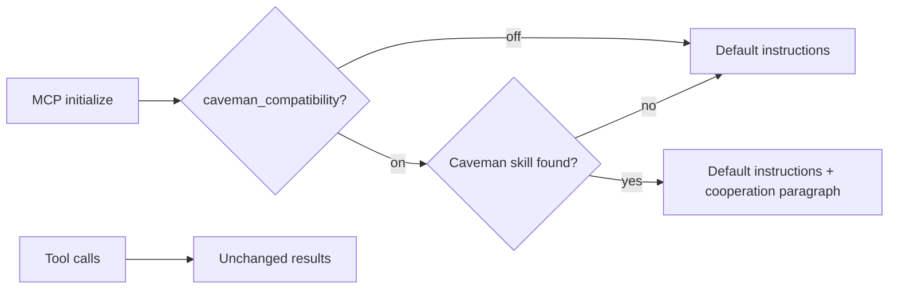

# Caveman compatibility

Design notes for the tokensave side of
[#797](https://github.com/aovestdipaperino/tokensave/issues/797). User
documentation is in
[Working alongside Caveman](guide/AGENT-INTEGRATIONS.md#working-alongside-caveman).

## Integration boundary

tokensave reduces what an agent reads. [Caveman](https://github.com/JuliusBrussee/caveman)
reduces what it writes, and optionally compresses model input through a proxy.
The integration is the smallest one that is useful:

- **Opt-in, off by default.** `caveman_compatibility = true` in
  `~/.tokensave/config.toml`, or `TOKENSAVE_CAVEMAN_COMPATIBILITY`, turns it
  on. When it is off, `initialize` reads only the config file and touches no
  agent file.
- **One instruction paragraph.** When it is on and a Caveman skill is found
  for a supported agent, `initialize` appends `COOPERATION_INSTRUCTIONS`
  (`src/caveman.rs`): keep using targeted queries, quote tokensave results
  exactly, user instructions take precedence. Tool schemas, `tools/list`,
  tool results and the default instructions do not change, so the
  `DEFAULT_FOOTPRINT_BYTES` baseline is unaffected.
- **Read-only diagnostics.** `tokensave doctor --caveman` adds a Caveman
  section to the normal doctor run and prints a JSON report per agent on
  stdout. Installation and session activation are separate fields.
- **Nothing installed or rewritten.** tokensave does not install, configure,
  run or uninstall Caveman. It does not edit Caveman, Cavecrew or agent
  files, and adds no dependency.

### Alternatives considered

| Option | Decision |
| --- | --- |
| Bundle or port Caveman's skill text | Rejected. Caveman owns its prose rules, and copying them would drift from upstream. |
| Compress tokensave results in the server | Rejected. Results are already compact, and lossy rewriting would remove identifiers, paths and line references needed for the next step. |
| Configure Caveman's proxy or `caveman-shrink` | Rejected. Both belong to the user's Caveman setup. An MCP server cannot set model-request headers, and no per-server exclusion interface was found. |
| Default-on cooperation | Rejected. #797 requires opt-in adoption. |
| Opt-in instruction paragraph and diagnostics | Chosen. |

## Upstream versions and compatibility

Session-state handling was checked against `src/hooks/caveman-config.js` at
Caveman [v4.0.1](https://github.com/JuliusBrussee/caveman/tree/9b68f7ed12b05e7efaff18e65c5a3fc2849fd0a4)
and [v4.1.0](https://github.com/JuliusBrussee/caveman/tree/1e91f1306d602d4ca23618701b1185575ae1869b)
(`VERIFIED_RELEASES`). Between them only the resolution of settings changed. The
per-session file (`<claude home>/.caveman-sessions/<id>.mode`, at most 64 bytes,
id matching `^[A-Za-z0-9_-]{1,128}$`), the mode names and the legacy aliases
are the same.

- Skill discovery covers Claude Code, Codex, Cursor, Copilot, Gemini,
  OpenCode, Pi and OMP. It honors `CLAUDE_CONFIG_DIR`, `CODEX_HOME` and
  OpenCode's `XDG_CONFIG_HOME`, and reads Claude's
  `plugins/installed_plugins.json` instead of scanning plugin caches.
- A plugin manifest next to the skill gives the release. A copied skill
  usually has none, so its release is reported as unknown.
- A release outside `VERIFIED_RELEASES` keeps the cooperation paragraph,
  which does not depend on Caveman internals. Its session state is not
  interpreted.
- Activation is reported only for a Claude Code session named with
  `--session-id`. No portable mapping from an MCP session to the host's
  session id exists, so `initialize` cannot know whether Caveman is active.
  The paragraph is therefore conditional ("If Caveman is active ...").
- The startup policy (`defaultMode`) is looked up the way Caveman does: up
  from the project through `.caveman/config.json` and `.caveman.json`, then
  `$XDG_CONFIG_HOME/caveman`, then `%APPDATA%\caveman` on Windows, then
  `~/.config/caveman`. It only produces warnings. `CAVEMAN_DEFAULT_MODE` is
  not read.
- Caveman's proxy can rewrite tool results after tokensave returns them.
  tokensave cannot prevent that, and `doctor --caveman` says so when a skill
  is found.

## License

Caveman v4.1.0 states Apache-2.0 for the whole repository (`LICENSE`), with
older releases and third-party notices in `LICENSING.md`; `LICENSE-MIT` and
per-component licenses also exist. tokensave copies no Caveman code or text.
It reads file names, the `name: caveman` line, the plugin manifest's `name` and
`version`, and the session mode string, so no license obligation follows.

## Resource review

Discovery runs once per MCP `initialize`, and only when the setting is on, and
once per `doctor --caveman`. Never per tool call. It reads a fixed set of
candidate paths plus the project's ancestors for the startup policy, at most
`MAX_REGISTRY_ENTRIES` (16) registry entries and at most `MAX_ARTIFACT_BYTES`
(64 KiB) per file. That bound holds if a file grows while it is read. Session
files must be regular, not symlinks, and at most 64 bytes. It keeps no cache,
starts no task or subprocess, and closes every file by RAII before returning.
No SQL changed.

## Validation

- `tests/caveman_test.rs` (13 tests) covers every supported agent, project
  and shared skills, the plugin registry, verified and unverified releases,
  malformed and foreign manifests, oversized files, invalid session ids,
  the mirror flag and startup defaults, the Cavecrew overlap warning, opt-out
  and removal, and the `doctor --caveman` CLI.
- `mcp::server` checks that cooperation adds only its paragraph. The
  default-footprint test checks that the default instructions are unchanged.
- `user_config` tests cover the default, round trip and a concurrent stale
  save.

## Remaining work for #797

- Measured comparison of baseline, tokensave alone, Caveman alone and both
  on the same tasks and models: input and output tokens, cost, latency,
  correctness and recovery. The benchmark harness from draft PR #800 is
  outside this change and needs its own PR with a CI job.
- Stock-agent trials that confirm the paragraph is followed, and a check
  of results that pass through Caveman's proxy.
- Porting to `beta`.
