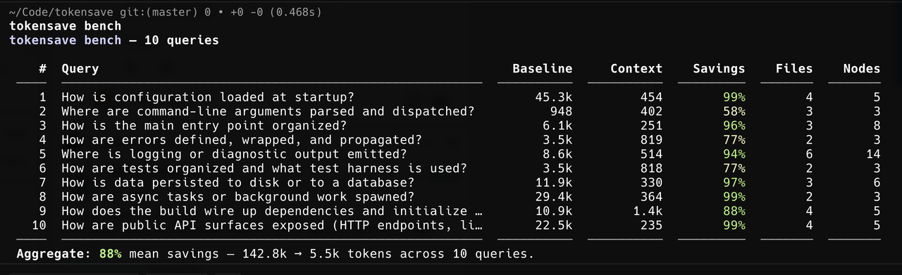

# Benchmarks

How to measure tokensave's retrieval savings and tool performance.

## Reproducible benchmark (`tokensave bench`)

`tokensave bench` runs a fixed query set through `tokensave_context` and reports retrieval savings vs a full-file baseline (mirrors the CCE methodology):

```bash
tokensave bench                                    # ships with 10 default queries
tokensave bench --queries my-queries.toml --json
tokensave bench --max-nodes 5
```

<p align="center">
  
</p>

**Measured against this repo (`tokensave` itself) using the shipped generic query set:**

| # | Query | Baseline | Context | Savings | Files | Nodes |
|---|---|---:|---:|---:|---:|---:|
| 1 | How is configuration loaded at startup? | 45.3k | 454 | 99% | 4 | 5 |
| 2 | Where are command-line arguments parsed and dispatched? | 948 | 402 | 58% | 3 | 3 |
| 3 | How is the main entry point organized? | 6.1k | 251 | 96% | 3 | 8 |
| 4 | How are errors defined, wrapped, and propagated? | 3.5k | 819 | 77% | 2 | 3 |
| 5 | Where is logging or diagnostic output emitted? | 8.6k | 514 | 94% | 6 | 14 |
| 6 | How are tests organized and what test harness is used? | 3.5k | 818 | 77% | 2 | 3 |
| 7 | How is data persisted to disk or to a database? | 11.9k | 330 | 97% | 3 | 6 |
| 8 | How are async tasks or background work spawned? | 29.4k | 364 | 99% | 2 | 3 |
| 9 | How does the build wire up dependencies and initialize state? | 10.9k | 1.4k | 88% | 4 | 5 |
| 10 | How are public API surfaces exposed (HTTP endpoints, library exports, or CLI commands)? | 22.5k | 235 | 99% | 4 | 5 |

**Aggregate:** 88% mean retrieval savings (142.8k → 5.5k tokens across 10 queries).

The default query set targets patterns present in most application codebases (CLIs, daemons, services). Run it on your own project with `tokensave bench` to see your numbers, or write a tailored query file (`--queries my.toml`) for tighter recall.

## Criterion bench against large real-world repos

`benches/large_repos.rs` is a [criterion](https://bheisler.github.io/criterion.rs/book/) micro-benchmark that exercises the MCP tools end-to-end against four large open-source codebases pinned at constant refs. Each tool is driven by **at least 5 queries** with arguments (node ids, qualified names, file globs, …) sampled from the indexed graph once per repo, so timings are reproducible across runs.

**Repos and pinned refs** (defined in `benches/repos.rs`):

| Repo | URL | Ref |
|---|---|---|
| polkadot-sdk | https://github.com/paritytech/polkadot-sdk | `polkadot-stable2412` |
| emacs | https://github.com/emacs-mirror/emacs | `emacs-30.1` |
| scipy | https://github.com/scipy/scipy | `v1.14.1` |
| node | https://github.com/nodejs/node | `v22.11.0` |

Each repo is shallow-cloned (`git init` + `git fetch --progress --depth 1 origin <ref>` + `checkout FETCH_HEAD`) on first use and cached locally; subsequent runs reuse the checkout. Git output is streamed to the terminal so the multi-GB fetch shows real-time progress.

**Tools covered (5 queries each).** Read tools — `search`, `context`, `callers`, `callees`, `node`, `by_qualified_name`, `signature`, `impact`, `body`, `files`, `complexity`, `doc_coverage`, `largest`, `hotspots`, `god_class`, `module_api`, `derives`, `dead_code`, `rank`, `coupling`, `circular`. Write tools — `str_replace`, `multi_str_replace`, `insert_at`, and (if `ast-grep` is on `PATH`) `ast_grep_rewrite`.

**Force-sync on every run.** Before any benchmark fires, the harness runs the equivalent of `tokensave sync --force` on each repo (`index_all()` regardless of `.tokensave/` freshness) so timings always reflect the pinned source.

**Write benches and cleanup.** Write tools mutate files. To keep the "match must be unique" precondition holding, the harness uses criterion's `iter_batched` — a small scratch file under `<repo>/.tokensave-bench-scratch/` is rewritten with known content **before every timed iteration**, then the edit tool runs against it. After all benchmarks finish, the harness runs `git stash --include-untracked && git stash drop` inside every prepared repo so the working tree returns to the pinned ref.

**Criterion configuration.** The bench overrides criterion's defaults to `sample_size = 10` and `measurement_time = 30s` (vs the stock 100 / 5s), which gives each per-query timing ~30 seconds of measurement — enough that slow tools like `tokensave_context` on polkadot-sdk produce stable numbers.

**Run it:**

```bash
# Required: a writable cache directory for the cloned repos + their indexes.
# Expect several GB of disk and a long first run (shallow clone + full index of each repo).
export TOKENSAVE_BENCH_REPOS_DIR=~/tokensave-bench-cache

cargo bench --bench large_repos
```

If `TOKENSAVE_BENCH_REPOS_DIR` is unset the bench prints a notice and registers zero benchmarks (so `cargo bench --all` stays cheap on contributors' machines).

**Configuration (all optional, via environment):**

| Variable | Effect |
|---|---|
| `TOKENSAVE_BENCH_REPOS_DIR` | **Required.** Root directory where each repo is cloned to `$DIR/<repo-name>/`. |
| `TOKENSAVE_BENCH_REPOS` | Comma-separated subset of repo names to bench, e.g. `TOKENSAVE_BENCH_REPOS=emacs,scipy`. Defaults to all four. |
| `TOKENSAVE_BENCH_SKIP_CLONE` | If set, the bench fails fast for any repo not already at its pinned ref instead of fetching. Useful in CI / offline runs. |

**Filtering benchmarks** uses the standard criterion CLI — for example, only the `search` tool on `scipy`:

```bash
cargo bench --bench large_repos -- 'scipy/tokensave_search'
```

Reports (HTML + raw samples) land under `target/criterion/`.

To change the pinned refs (e.g. to a newer release or a specific SHA), edit `REPOS` in `benches/repos.rs` and delete the corresponding `$TOKENSAVE_BENCH_REPOS_DIR/<repo>/.bench-ref` marker so the next run re-fetches. If you skip the post-run cleanup (e.g. you `Ctrl-C` mid-bench), running `git stash --include-untracked && git stash drop` inside each repo dir restores it manually.

## MCP test-matrix probe (`scripts/mcp_probe`)

`scripts/mcp_probe/` is a Python harness that drives `tokensave serve` over stdio against a configurable set of real repos and exercises **every read-only MCP tool with 5 query variants per language**, producing a per-tool / per-repo status table. Same harness serves two purposes:

- **Regression sweep.** New language support, new tool, or a refactor — re-run the matrix and any cell that newly errors, times out, or returns empty results stands out as a 🚩.
- **Perf probe.** Per-call timings are logged in TSV; the same fixed corpus of repos doubles as a coarse cross-version comparison. The current `tokensave_inheritance_depth` cycle bug was found by this harness when a single tool on polkadot-sdk timed out at >60 s.

**Layout** — `probe.py` is the driver (id-matched JSON-RPC so a slow tool can't poison subsequent calls), `isolated.py` re-runs a single tool with a fresh server per call (escapes server queueing), `build_matrix.py` reads the TSV and emits markdown, `tools/<lang>.py` modules contribute per-language query sets (Rust shipped; add Python/Go/… by dropping a new module), `repos.toml` lists target repos (override via `$TOKENSAVE_PROBE_REPOS`).

**Quick run:**

```bash
cargo build --release --bin tokensave
python3 scripts/mcp_probe/probe.py
python3 scripts/mcp_probe/build_matrix.py > matrix.md
```

Output cells are `✓ 5/5` (clean), `🐛 e/N` (errors), `⏱ N/N` (timeouts), `∅ E/N` (empty), `🐢 ok/slow` (>10 s calls). Any cell carrying an error or timeout earns a 🚩 in the rightmost column. Per-call detail with the first 100 chars of each error lands in the TSV log for follow-up.

Different from the criterion bench above: criterion measures per-iteration latency for a focused tool set on pinned refs and produces statistical reports under `target/criterion/`; `mcp_probe` exercises every tool with a broader query set on whatever repos you point it at, optimising for breadth of coverage rather than measurement precision.
