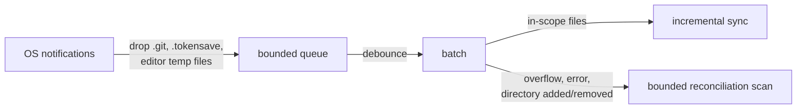

# Indexing and Freshness

How tokensave builds the graph, finds the project you are in, keeps the index fresh, and decides what gets indexed.

## Indexing a project

```bash
cd /path/to/your/project
tokensave init
```

This creates a `.tokensave/` directory with the knowledge graph database. After `init`, use `tokensave sync` to incrementally update -- only changed files are re-indexed. A repository you start with `git init` can also be initialized for you; see [Automatic initialization](#automatic-initialization).

The [user guide](../USER-GUIDE.md#your-first-index) covers skipped folders,
`.gitignore` handling, forced re-indexing, and diagnosing slow syncs.

## Keeping state outside the repository

By default the index and the rest of a project's state live in `.tokensave/` at the project root, which `init` adds to `.git/info/exclude`. To create nothing inside your repositories, set a base state directory:

- `TOKENSAVE_STATE_DIR=/path/to/state` in the environment, or
- `state_dir = "/path/to/state"` in `~/.tokensave/config.toml`.

The environment variable wins over the config file; set but empty, it selects the default layout. The value must be an absolute path or start with `~`; anything else is ignored, and `tokensave doctor` says so. The config-file value is read when a tokensave process starts, so restart MCP servers after changing it. Set it in the config file rather than the environment if you rely on git hooks, which run without your shell's variables.

With a base set, each project keeps its state in `<base>/projects/<name>-<hash>/`. Prerelease builds use a `beta` subdirectory there, as they do under `.tokensave/`. `<hash>` comes from the project root's canonical absolute path (lowercased on Windows), so the same checkout always maps to the same directory, and each linked worktree gets its own. `<name>` is the root's folder name, to make the directories recognizable. Each one holds an `origin.json` recording the project root. Nothing is written under the project root, and `.git/info/exclude` is left untouched.

Changing the setting never loses an index:

- A project that already has `.tokensave/` keeps using it after you set a base. To move it, stop its MCP servers and move the directory to the path `tokensave doctor` names.
- Every base that has held state is recorded in `~/.tokensave/state-bases.json`. When the configured location (or the default) has no state for a project, state under a recorded base is used.

`tokensave doctor` reports the effective setting, a project whose state is not where the setting puts it, and relocated state whose project directory no longer exists. Deleting a checkout leaves its relocated state behind; `tokensave state list` shows every relocated directory, and `tokensave state prune` deletes the orphans (preview with `--dry-run`). Only directories whose recorded project root is gone are deleted.

## Automatic initialization

A cloned repository is indexed by the `post-checkout` hook on its first checkout. A repository started with `git init` gets no checkout, so the `auto_init` setting (on by default) covers it. Two entry points initialize a git repository that has no index yet:

- **The first commit.** The `post-commit` and `post-merge` hooks run `tokensave sync` with no path. In a repository with no index, that `sync` runs `init` instead of failing. Hooks installed by earlier versions get this behavior too: the decision is made by the binary, not the hook script.
- **The MCP server.** `tokensave serve` started at the top level of such a repository initializes and indexes it before it answers the first request. This also covers machines without the global git hooks.

Both apply only when every guard passes. Otherwise `sync` fails as it always has, and `serve` falls back as usual.

- The directory is the top level of a git working tree. A subdirectory, a bare repository, a folder outside any repository, and an explicit `sync <path>` or `serve --path` never qualify, so no state is created outside the repository root.
- No project already owns the directory, including an outer non-git workspace that indexes the repository.
- The repository is not under the system temp dir, where other tools stage throwaway clones, and is not your home directory itself.
- The repository has no more candidate files than `max_auto_sync_files` (2,000). A larger tree, such as `git init` in an existing large directory, is not indexed; `sync` prints a hint to run `tokensave init` deliberately.

To turn it off, set `auto_init = false` in `~/.tokensave/config.toml`. `TOKENSAVE_AUTO_INIT` overrides the setting for one run: `0`, `false`, `no`, `off` or an empty value turn it off, and any other value turns it on. `tokensave doctor` reports the effective value.

## Running from subdirectories

Every command finds the project that owns the current directory by walking up to the nearest `.tokensave/`, so you can run it from anywhere inside the project:

```bash
cd repository
tokensave init                     # creates repository/.tokensave/

cd src/backend/services
tokensave tool search database     # searches the repository's index
tokensave init                     # reports the existing project; exits 0, indexes nothing

cd ../..
tokensave sync                     # syncs the repository's index
```

The MCP server and the agent hooks resolve the project the same way. Search paths stay relative to the project root (`src/backend/db.rs`). Note that an MCP server launched from a subdirectory still uses that subdirectory as its default path filter for listing tools.

- **Git repositories.** If no project exists yet, `init` from inside a git repository initializes the repository root (or the linked worktree root), not the current directory.
- **Repository boundaries.** A git repository root is an isolation boundary. Inside a nested, independent repository (a nested clone or a submodule), commands never use an outer repository's index; run `tokensave init` there to give it its own. A linked worktree nested in its main checkout borrows the main index until it has an index of its own. The MCP server puts the borrowed-worktree notice on each response. `tokensave status`, `tokensave sync` and `tokensave tool` print it on stderr. Run `tokensave init` in the worktree to give it its own index.
- **Non-git projects.** A `.tokensave/` in a folder that is not inside a git repository works the same way, including for any repositories inside that folder.
- **Linked worktrees inside a checkout.** The index of a checkout does not include a linked worktree that lies inside it (`git worktree add <dir>` run in the repository). That directory is a second working tree of the same repository, so the scan does not enter it, and no `include` or `force_include` glob admits it. To index it, run `tokensave init` in the worktree. A nested clone and a submodule are repositories of their own, and the scan enters them as before.
- **Explicit roots.** `tokensave init <path>`, `--path` (`-p`), and `tool --project <path>` use the directory you pass, with no discovery.
- **Broken installs.** A `.tokensave/` with a `config.json` but no database is reported instead of being skipped in favor of an outer project. A config that cannot be parsed is an error that names the file to fix.

## Index freshness

By default, tokensave keeps the graph up to date without a background daemon or an OS-level file watcher. An [opt-in filesystem watcher](#opt-in-filesystem-watcher) can be turned on for `tokensave serve`; it adds to the mechanisms below rather than replacing them.

**On-demand staleness check.** Every MCP tool call checks whether any indexed files have been modified since the last sync. If stale files are found, they are re-extracted before the tool response is returned. A 30-second cooldown prevents back-to-back calls from re-walking the tree on every keystroke.

**Catch-up sync on connect.** When the MCP server starts, it immediately runs a non-blocking catch-up sync that picks up any changes made while no agent was attached — a `git pull`, an IDE edit, a build step — so the very first tool call of a session sees a fresh index.

**Staleness fields in `tokensave_status`.** `stale_files` counts sampled indexed files whose contents changed since they were indexed; it is the signal that the index content needs a sync. `stale_commits` (with `stale_warning`) counts Git commits reachable from `HEAD` whose committer time is strictly later than the last successful sync. Every successful sync resets it, including one that finds nothing to reindex, so a commit that touches no indexed file is counted only until the next sync. Committer times record when a commit was created, not when it reached the checkout: a commit created before the last sync and pulled afterwards is not counted.

**Multi-agent work and git worktrees.** When multiple agents work on the same project concurrently, the strong assumption is that each agent operates in its own git worktree. Worktrees are independent filesystem checkouts of the same repository: agent A and agent B each have their own copy of every file, so they never overwrite each other's in-flight edits. tokensave automatically detects when a query comes from a worktree nested inside the main checkout and serves results from the correct branch graph. Changes accumulate independently and are eventually reconciled via git merge or rebase — the same process used for any other parallel development. This design avoids the complexity and failure modes of cross-agent locking over a shared mutable directory.

**CLI-only workflows.** If you run `tokensave` commands without an attached agent (no MCP server), the staleness check is not running between commands. Install git hooks to keep the index fresh automatically after every commit or clone:

```bash
cp scripts/post-commit scripts/post-checkout .git/hooks/
chmod +x .git/hooks/post-commit .git/hooks/post-checkout
```

`tokensave install` can also set up global hooks; see
[Keeping the Index Fresh](../USER-GUIDE.md#keeping-the-index-fresh) in the user guide.

### Opt-in filesystem watcher

The MCP server can follow file changes as they happen, through the operating system's file notifications (inotify on Linux, FSEvents on macOS, ReadDirectoryChangesW on Windows, kqueue on the BSDs). The watcher is **off by default**. With it off, `serve` creates no watcher, registers no directory and starts no watcher task.

Turn it on for every `serve` in `~/.tokensave/config.toml`:

```toml
filesystem_watch_enabled = true   # default: false
watcher_debounce = "2s"           # quiet period before a burst is applied
```

or for one run with `tokensave serve --watch`. `watcher_debounce` accepts `"500ms"`, `"2s"`, `"1m"` or a bare number of seconds, and is clamped to 50 ms – 60 s; an invalid value falls back to 2 s with a warning.



How it behaves:

- **Same pipeline, same scope.** A batch of changed files goes through the same incremental sync as the on-demand check. A new file is indexed only if a full scan would index it: exclude globs, `.gitignore` (including ignored parent directories), hidden directories, `force_include`, extension and size rules all apply. Changes inside `.git/` and tokensave's own `.tokensave/` directory are ignored, so the database writes cannot trigger new syncs.
- **Debounced.** Events are collected until no new one arrives for `watcher_debounce`, and a continuous stream is applied at least every five debounce periods (between 5 and 60 seconds).
- **Bounded.** The queue between the notification thread and the batcher holds at most 1,024 events, and one batch at most 4,096 distinct paths. When either fills, or the operating system reports dropped events or a watcher error, the batch becomes a reconciliation: the same bounded scan the startup catch-up runs, limited by `max_auto_sync_files` and refused on a branch drift. Reconciliations run at most once every 10 seconds; a later one is scheduled instead.
- **Directories.** A created or renamed-in directory, or a removed one, triggers a reconciliation, because its contents arrive without events of their own.
- **Starts after the catch-up.** The watcher starts once the startup catch-up sync finishes. Changes made while no server was running are reconciled by that scan, not by the watcher: notifications are not a durable log.
- **Shutdown.** The watcher is stopped and all watches are released when the server shuts down, before the database is checkpointed.
- **Observable.** `tokensave_status` reports a `filesystem_watch` object under `server`: its `state` (`off`, `starting`, `active`, `failed` or `stopped`), mode, number of watched directories, batches, reconciliations, dropped events, error count and the last error. Errors are also logged to stderr.

Platform notes and limits:

- **Linux and the BSDs** register one non-recursive watch per directory that a scan would enter, so ignored and excluded trees such as `node_modules/` or `target/` use no watches. New directories are added as they appear. The watcher does not start when the project has more than 16,384 such directories. If the kernel's watch limit is reached, the error names `fs.inotify.max_user_watches`. A gitignored directory admitted only by `force_include` is not watched; the on-demand check still covers it.
- **macOS and Windows** register a single recursive watch on the project root, because the native APIs are recursive. Events from ignored directories still reach tokensave and are discarded there, so a large build writing into an ignored directory costs some CPU while it runs.
- **Network and virtual filesystems** (NFS, SMB, some container mounts, WSL paths accessed from Windows) may deliver no notifications. The on-demand check keeps working there.
- **Branch switches.** In multi-branch mode, the watcher pauses while the working tree is on a branch other than the one being served, like every automatic sync.
- The watcher runs only inside `tokensave serve`. CLI-only workflows still rely on git hooks.

## Crash-resilient sync

Tree-sitter grammars are compiled C/C++ code. They occasionally hit an internal assertion or otherwise terminate the process by paths that Rust panic handling cannot intercept. As of v4.3.0, every file is parsed inside a short-lived worker subprocess: if a grammar segfaults, calls `abort()`, or hits a stack overflow, only the worker dies. The pool respawns it, the offending file is logged and skipped, and `sync` keeps going.

The worker is a hidden `extract-worker` subcommand authenticated against the parent via a 256-bit per-spawn token, required as both a `TOKENSAVE_WORKER_TOKEN` env var and as the first 32 bytes received on stdin. Direct invocation by users fails. Worker concurrency follows `cpu_usage` in `.tokensave/config.json`: `low` uses one worker, `balanced` (default) uses half the available CPUs rounded up, and `performance` uses all available CPUs. The first `tokensave init` on a machine benchmarks it once and saves the recommended profile in `~/.tokensave/benchmark.toml`, which every project without its own `cpu_usage` reuses; `tokensave config benchmark [--force|--show|--reset]` manages that result, and `TOKENSAVE_CPU_USAGE` or a global `cpu_usage` in `~/.tokensave/config.toml` override it (see the [user guide](../USER-GUIDE.md#cpu-usage-profiles)). `memory_usage` independently limits simultaneous extraction parsers: `low` uses one, `balanced` (default) at most two, and `performance` retains the CPU ceiling. An automatic preflight check can further lower parser concurrency when physical RAM headroom is limited, including in `performance` mode. This reduces parser memory at a possible throughput cost; total graph memory remains proportional to the project, so it is not a hard RAM cap. `TOKENSAVE_WORKERS` can lower the subprocess limit further. These limits are not CPU-percentage caps. Restart the MCP server after changing the profile; opt out of subprocess isolation with `TOKENSAVE_DISABLE_SUBPROCESS=1`.

Edit primitives (`tokensave_str_replace`, `tokensave_insert_at`, etc.) still run in-process: they target one file at a time where subprocess overhead would dominate, and an extractor crash there is immediately visible to the agent.

## Custom source extensions

Map extensions to an enabled extractor in `.tokensave/config.json`:

```json
"language_aliases": { ".t": "perl", ".ep": "perl" }
```

This parses legacy Perl tests without renaming them. Keys accept an optional
leading dot and match case-insensitively; invalid, conflicting, unknown, or
disabled mappings fail sync with a configuration error. Aliases override built-in
extension associations and artifact tracking. Use existing `project.json`
`entries` with `language` for file/glob overrides, which take priority over
aliases. Run `tokensave sync` after editing mappings (`sync -f` also works).
See the [configuration guide](../USER-GUIDE.md#custom-language-extensions).

## Default excludes

A new project's `.tokensave/config.json` starts with `exclude` globs for
dependency, tool-state and build-output directories, such as `**/node_modules/**`,
`**/vendor/**`, `**/.venv/**`, `**/target/**`, `**/build/**`, `**/out/**` and `bin/**`.
Files under them are not indexed. Edit the list and run `tokensave sync` to change it.

Three of these defaults, `**/build/**`, `**/out/**` and `bin/**`, are meant for
generated output but are also common names for real source: a Python package
imported as `build.extract`, or a `bin/` of scripts. When git tracks indexable
files that only these globs exclude, `init` and `sync` print a warning:

```text
warning: excluded 2 tracked files by default build-output excludes (build: 2) — if they are source, remove "**/build/**" from exclude[] in .tokensave/config.json and run `tokensave sync` to index them (or add "build/**" to exclude[] to keep them excluded and silence this warning)
```

- To index the files, remove the named glob from `exclude` and run `tokensave sync`.
- To keep them excluded, add the suggested explicit glob. A file matched by any
  exclude glob other than these three defaults counts as deliberately excluded
  and is not reported.

Only files with an extension an extractor handles are counted. Files in hidden
directories get their own warning instead. The other defaults are not reported:
their contents are rarely source, and tracked `vendor/` code is usually excluded
on purpose. The check needs a git repository and is skipped outside one.

## Non-code artifacts

`tokensave_files` covers more than source. Files whose extension is listed in
`artifact_extensions` (`.feature`, `.json`, `.yaml`, `.yml`, `.sql`, `.toml`,
`.proto`, `.graphql`, `.md`, `.bnd`, `.bndrun` by default) are tracked by path
so questions like "where are the `.feature` files for the login flow?" have a
graph answer rather than a blocked `find` (#323). They are never parsed and contribute no symbols;
`kind: "artifact"` and `kind: "code"` filter between the two, and analyses that
mean "code" exclude them. An extension already handled by a language extractor
is ignored in this list, so it cannot be used to stop a language being parsed.

The list also decides what **literal search can look inside** (#442). A literal
(`literal: true`) search over `tokensave_search` reads bytes rather than
symbols, so it needs no parser -- but it iterates the indexed files, so it can
only reach a file the index holds a row for. A tracked `.rst` document or
`.tmpl` template has neither an extractor nor a default artifact entry, so its
matches are missing; add the extension here and run `tokensave sync -f` and its
lines are searched like any other, reported with `enclosing: null` since there
is no symbol context. A literal response that could not reach every tracked
file says so in an `unscanned` block naming the count and the extensions, so a
partial answer is never presented as a complete one.
