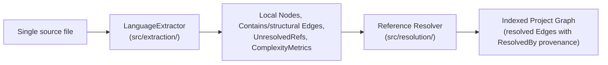

# Supported Languages

The languages tokensave indexes, the Cargo feature tiers that select them, and how to add or upgrade a language extractor.

## Language tiers

tokensave supports more than 50 programming languages organized into three tiers controlled by Cargo feature flags (`lite`, `medium`, `full`). Each tier includes all languages from the tier below it.

Tiers are **compilation feature groups**, not semantic quality levels: they exist to keep binary size and compile times smaller when you do not need every grammar. Improving an extractor does **not** require moving a language between tiers, and a language in `Full` can be upgraded in place without changing `Cargo.toml` tier membership.

Markdown headers are extracted as `Module` nodes with hierarchical `Contains` edges so document structure participates in graph queries alongside source code.

### Lite -- `--no-default-features`

Always compiled. The smallest binary for the most popular languages, plus Svelte and Astro (script-block extraction via the TypeScript extractor, no extra grammar dependency).

| Language | Extensions |
|----------|-----------|
| Rust | `.rs` |
| Go | `.go` |
| Java | `.java` |
| Scala | `.scala`, `.sc` |
| TypeScript | `.ts`, `.tsx` |
| JavaScript | `.js`, `.jsx` |
| Python | `.py` |
| C | `.c`, `.h` |
| C++ | `.cpp`, `.hpp`, `.cc`, `.cxx`, `.hh` |
| Kotlin | `.kt`, `.kts` |
| C# | `.cs` |
| Swift | `.swift` |
| Svelte | `.svelte` |
| Astro | `.astro` |

### Medium (Lite + 9 more) -- `--features medium`

| Language | Extensions | Feature flag |
|----------|-----------|-------------|
| Dart | `.dart` | `lang-dart` |
| Pascal | `.pas`, `.pp`, `.dpr` | `lang-pascal` |
| PHP | `.php` | `lang-php` |
| Ruby (including ERB and Slim templates) | `.rb`, `.rake`, `.erb`, `.slim` | `lang-ruby` |
| Bash | `.sh`, `.bash` | `lang-bash` |
| Protobuf | `.proto` | `lang-protobuf` |
| PowerShell | `.ps1`, `.psm1` | `lang-powershell` |
| Nix | `.nix` | `lang-nix` |
| VB.NET | `.vb` | `lang-vbnet` |

ERB and Slim templates use the Ruby grammar without requiring Ruby or template gems at indexing time. Template calls belong to the file node and retain their original line and byte column. ERB supports code/output tags, trim markers, comments, and escaped tags. Slim supports control/output lines, indentation-based blocks, attributes (including multiline attribute lists), text interpolation, and `ruby:` blocks.

Custom Slim shortcuts and embedded-language compilation are not supported. Locals supplied by Rails at render time cannot be distinguished from bare helper calls; names assigned or bound in the template are excluded conservatively. Controller-to-view and partial-render relationships require separate Rails semantic wiring.

### Full (Medium + everything else) -- default

| Language | Extensions | Feature flag |
|----------|-----------|-------------|
| ActionScript | `.as` | `lang-actionscript` |
| Lua | `.lua` | `lang-lua` |
| Zig | `.zig` | `lang-zig` |
| Objective-C | `.m`, `.mm` | `lang-objc` |
| Perl | `.pl`, `.pm` | `lang-perl` |
| Batch/CMD | `.bat`, `.cmd` | `lang-batch` |
| Fortran | `.f90`, `.f95`, `.f03`, `.f08`, `.f18`, `.f`, `.for` | `lang-fortran` |
| COBOL | `.cob`, `.cbl`, `.cpy` | `lang-cobol` |
| MS BASIC 2.0 | `.bas` | `lang-msbasic2` |
| GW-BASIC | `.gw` | `lang-gwbasic` |
| QBasic | `.qb` | `lang-qbasic` |
| QuickBASIC 4.5 | `.bi`, `.bm` | `lang-qbasic` |
| Dockerfile | `Dockerfile`, `.dockerfile` | `lang-dockerfile` |
| GLSL | `.glsl`, `.vert`, `.frag`, `.comp` | `lang-glsl` |
| Godot Shader | `.gdshader`, `.gdshaderinc` | `lang-glsl` |
| GDScript | `.gd` | `lang-gdscript` |
| Minecraft Function | `.mcfunction` | `lang-mcfunction` |
| WGSL | `.wgsl` | `lang-wgsl` |
| HLSL | `.hlsl`, `.fx` | `lang-hlsl` |
| Verilog / SystemVerilog | `.v`, `.vh`, `.sv`, `.svh` | `lang-systemverilog` |
| VHDL | `.vhd`, `.vhdl` | `lang-vhdl` |
| Metal | `.metal` | `lang-metal` |
| CUDA / HIP | `.cu`, `.cuh` | `lang-cuda` |
| Markdown | `.md`, `.markdown` | `lang-markdown` |
| Obsidian Canvas | `.canvas` | `lang-canvas` |
| R | `.r`, `.R` | `lang-r` |
| SQL | `.sql` | `lang-sql` |
| Julia | `.jl` | `lang-julia` |
| Haskell | `.hs`, `.lhs` | `lang-haskell` |
| OCaml | `.ml`, `.mli` | `lang-ocaml` |
| Clojure | `.clj`, `.cljs`, `.cljc` | `lang-clojure` |
| Erlang | `.erl`, `.hrl` | `lang-erlang` |
| Elixir | `.ex`, `.exs`, `.eex` | `lang-elixir` |
| F# | `.fs`, `.fsi`, `.fsx` | `lang-fsharp` |
| F* | `.fst`, `.fsti` | `lang-fstar` |
| Quint | `.qnt` | `lang-quint` |
| Terraform | `.tf`, `.tfvars` | `lang-terraform` |
| TOML | `.toml` | `lang-toml` |
| Lean | `.lean` | `lang-lean` |
| XAML | `.xaml`, `.axaml` | `lang-xaml` |
| HTML | `.html`, `.htm` | `lang-html` |
| CSS | `.css` | `lang-css` |

Individual languages can also be cherry-picked without a full tier:

```bash
cargo install tokensave --no-default-features --features lang-nix,lang-bash
```

## Extraction depth and scope

Extractors target the same shared graph schema (`Node`, `Edge`, `UnresolvedRef`, and complexity metrics in [src/types.rs](../../src/types.rs)), but **extraction depth varies by language**. Mature extractors cover rich language-specific constructs such as member visibility, inheritance/interfaces, decorators/annotations, docstrings, nested scopes, receiver types, and detailed complexity metrics; newer or lighter extractors may start with top-level declarations, imports, calls, and baseline complexity counts and grow incrementally over time.

Non-callable markup and configuration languages also use language-appropriate graph models rather than forcing function/call-graph semantics:

- **HTML and CSS** have no callable symbols. HTML records elements carrying an `id`, custom elements, and the stylesheets and scripts a page pulls in; CSS records class and id selectors, custom properties, `@keyframes` names, and `@import`s. Neither resolves a `class="..."` attribute to a stylesheet rule: class names are ordinary words, and matching them by bare name across a whole project invents edges rather than finding them.
- **Markdown, TOML, Dockerfile, XAML, and Obsidian Canvas** model document sections, keys/stages, UI elements, or canvas nodes and links rather than executable call graphs.

## Syntactic extraction vs. semantic resolution

tokensave splits indexing into two distinct stages so language extractors stay self-contained and fast:



- **Syntactic extraction ([src/extraction/](../../src/extraction/mod.rs))** parses one file at a time with tree-sitter (or a lightweight parser for formats like JSON Canvas). An extractor emits local `Node`s, structural `Edge`s (such as `EdgeKind::Contains`), complexity counts, and raw `UnresolvedRef` entries (such as call targets, type references, or imports) without reading other files.
- **Semantic cross-file resolution ([src/resolution/](../../src/resolution/resolver.rs))** runs across the indexed project graph after extraction. It matches each `UnresolvedRef` against candidate `Node`s using exact and qualified-path lookup, language-aware receiver/import strategies (such as Go selector imports, Ruby self/constant receivers, GDScript typed receivers, and relative JS/TS imports), common-name blocklists (`CROSS_FILE_BLOCKLIST`), and disambiguation scoring. Resolved edges carry `ResolvedBy` provenance in [src/types.rs](../../src/types.rs).

When improving support for a language, most symbol, member, docstring, visibility, nesting, and complexity gaps belong in the extractor (`src/extraction/{lang}_extractor.rs` and `src/extraction/complexity.rs`). Cross-file binding accuracy, import mapping, or receiver-type disambiguation belongs in `src/resolution/`.

## Adding or upgrading a language extractor

Whether you are adding a new language or deepening an existing one, keep changes scoped to small, well-tested pull requests and follow [CONTRIBUTING.md](../../CONTRIBUTING.md).

### 1. Grammar loading

If you are upgrading an existing extractor, its grammar is already wired. For a new language, grammars enter tokensave through one of three paths:

1. **Bundled grammar crate (`tokensave-large-treesitters`)**: loaded once into `LANGUAGES` in [src/extraction/ts_provider.rs](../../src/extraction/ts_provider.rs) and fetched by key with `ts_provider::language("<key>")`.
2. **Optional crates.io grammar dependency**: declared as `optional = true` in [Cargo.toml](../../Cargo.toml), activated by `lang-<name> = ["dep:tree-sitter-..."]`, and inserted into `LANGUAGES` in `src/extraction/ts_provider.rs` behind `#[cfg(feature = "lang-<name>")]` (or loaded directly by the extractor, as [TerraformExtractor](../../src/extraction/terraform_extractor.rs) does with `tree-sitter-hcl`).
3. **Vendored C grammar**: placed under `vendor/<grammar>/src/`, registered in `VENDORED_GRAMMARS` in [build/constants.rs](../../build/constants.rs) so [build.rs](../../build.rs) compiles it with `cc` when `CARGO_FEATURE_LANG_<NAME>` is set, and linked via `unsafe extern "C"` and `tree_sitter_language::LanguageFn::from_raw` in `src/extraction/ts_provider.rs` (used by `wgsl`, `actionscript`, and `gdscript`).

Some extractors need no new grammar at all: `SvelteExtractor` and `AstroExtractor` reuse the TypeScript extractor, `RubyTemplateExtractor` reuses the Ruby grammar, and `CanvasExtractor` parses JSON directly.

### 2. Feature flags

- Lite languages are always compiled and have no `lang-*` flag.
- Medium and Full languages define `lang-<name>` under `[features]` in [Cargo.toml](../../Cargo.toml) and are listed in the `medium` or `full` feature group.
- Upgrading an existing language does not require moving it from `full` to `medium` or `lite`.

### 3. Extractor implementation and registration

- Create or update `src/extraction/{lang}_extractor.rs` implementing [LanguageExtractor](../../src/extraction/mod.rs) (`extensions()`, `language_name()`, and `extract(file_path, source) -> ExtractionResult`).
- Declare the module, re-export the struct, and push `Box::new(...)` inside `LanguageRegistry::new()` in [src/extraction/mod.rs](../../src/extraction/mod.rs), gated with `#[cfg(feature = "lang-<name>")]` for Medium and Full languages.
- For tree-sitter languages that should also support syntax-aware re-parsing (such as `tokensave_rename`), register the file extensions in `ts_provider::language_for_path` and add the grammar key to `ts_provider::tests::all_extractor_keys_are_registered` in [src/extraction/ts_provider.rs](../../src/extraction/ts_provider.rs).

### 4. Graph mapping and complexity

- Use [ExtractionState](../../src/extraction/ts_state.rs) to collect `nodes`, `edges`, `unresolved_refs`, and `errors`, and to maintain `node_stack` for qualified names and parent containment.
- Reuse existing [NodeKind](../../src/types.rs) variants (`File`, `Module`, `Class`, `Struct`, `Enum`, `EnumVariant`, `Interface`, `Trait`, `Function`, `Method`, `Field`, `Const`, `TypeAlias`, `Use`, etc.) and [EdgeKind](../../src/types.rs) variants (`Contains`, `Calls`, `Uses`, `Implements`, `Extends`, `TypeOf`, `Returns`, `Annotates`, etc.) whenever possible instead of adding language-specific variants.
- Generate deterministic node IDs with `generate_node_id(file_path, &kind, &name, start_line)` and connect child declarations to their enclosing scope via `EdgeKind::Contains`.
- Emit cross-symbol references as `UnresolvedRef` records with accurate line/column coordinates so [src/resolution/resolver.rs](../../src/resolution/resolver.rs) can bind them across files.
- Define or refine a `ComplexityConfig` entry in [src/extraction/complexity.rs](../../src/extraction/complexity.rs) and call `count_complexity(node, &<LANG>_COMPLEXITY, &state.source)` on callable nodes.

### 5. Testing and verification

- Add representative sample code (inline or under `tests/fixtures/`) and create or extend `tests/{lang}_extraction_test.rs`. For Medium/Full languages, gate the test module with `#![cfg(feature = "lang-<name>")]`.
- Register any new test file as `mod {lang}_extraction_test;` in [tests/integration.rs](../../tests/integration.rs) (`Cargo.toml` sets `autotests = false`, so test files are not auto-discovered; see [Test layout](../../CONTRIBUTING.md#test-layout)).
- Verify both feature-isolated and default builds, plus formatting and lints:

```bash
cargo test --locked --no-default-features --features lang-<name> --test integration <lang>_extraction_test::
cargo test --locked --test integration <lang>_extraction_test::
cargo fmt --all -- --check
cargo clippy --workspace --all-targets --locked
```

- Update this page (and `CHANGELOG.md` under `[Unreleased]`) when adding a language or closing documented limitations, and validate doc links with `python3 scripts/wiki/sync_wiki.py check`.

## Known limitations: F#

F# (`.fs`, `.fsi`, `.fsx`, feature `lang-fsharp`) is implemented in [src/extraction/fsharp_extractor.rs](../../src/extraction/fsharp_extractor.rs) using the bundled `fsharp` grammar from `tokensave-large-treesitters`.

**Currently extracted:**

- `namespace`, `module_defn`, and `named_module` declarations as `NodeKind::Module` (with nested `Contains` edges for child modules and top-level bindings).
- `open_decl` statements as `NodeKind::Use` nodes.
- `function_or_value_defn` bindings as `NodeKind::Function` (when `function_declaration_left` has parameter children beyond the name) or `NodeKind::Const` (otherwise), including leading `///` XML doc comments, `FSHARP_COMPLEXITY` metrics, and `UnresolvedRef` `Calls` collected from `application_expression` nodes.
- Top-level `type_definition` declarations as `NodeKind::Class`.

**Current limitations (good self-contained follow-up PRs):**

- **Flat type definitions:** every `type_definition` (records, discriminated unions, classes, structs, interfaces, enums, and type abbreviations) is emitted as `NodeKind::Class` without descending into its body. Record fields, union cases, members/methods, constructors, inheritance/interface relationships, and XML doc comments on types are not yet extracted.
- **No nested bindings:** `visit_function_or_value` scans function bodies only for calls (stopping at nested `function_or_value_defn` and `type_definition` nodes), so nested `let` helpers and local types are not emitted as nodes.
- **Hard-coded visibility and async metadata:** declarations default to `Visibility::Pub` (and `open_decl` to `Visibility::Private`) without inspecting `private`/`internal` accessibility modifiers, and `is_async` is always `false` (computation expressions such as `async { ... }` and `task { ... }` are not detected).
- **Incomplete call and language-construct coverage:** calls are extracted only from the first child of `application_expression`, so pipe chains (`|>`), member/dot invocations, and curried/qualified applications can yield raw or partial callee names; attributes (`[<...>]`), active patterns, and `.fsi` signature-to-implementation pairing are not yet modeled.
- **Baseline complexity and test coverage:** `FSHARP_COMPLEXITY` in [src/extraction/complexity.rs](../../src/extraction/complexity.rs) tracks `if`/`elif`/`match`, `for`/`while`, `sequential_expression` nesting, and basic assertion names, but does not yet count individual match cases, early exits, or Halstead operators/operands; F# also does not yet have a dedicated `tests/fsharp_extraction_test.rs` integration suite.
