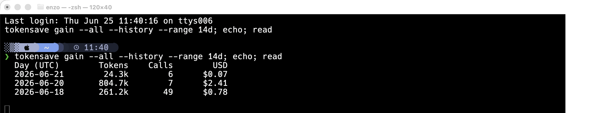
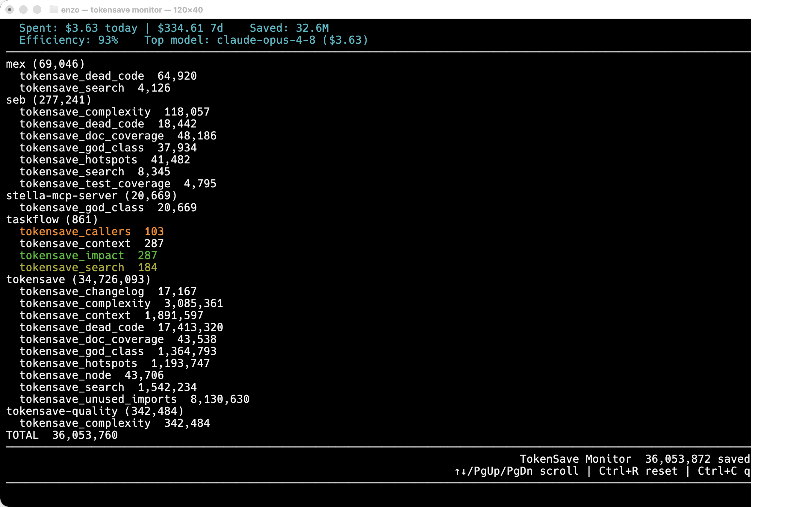
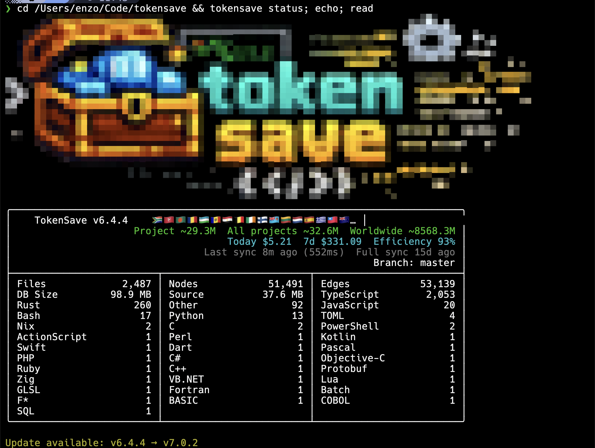

# Token Tracking and Cost

How tokensave measures the tokens it saves, and the commands that report savings, cost, and resource use.

## Per-call metrics

tokensave measures the tokens it saves on every MCP tool call. Each tool response includes a `tokensave_metrics: before=N after=M` line showing how many raw-file tokens were avoided by that specific call.

**Turning the reporting off.** The metrics line, together with a sentence in the MCP `instructions`, asks the agent to report savings to you — which means the model spends *output* tokens narrating a saving tokensave made on *input* tokens. Output tokens are the more expensive kind, so if your agent mentions tokensave on nearly every turn, that narration can offset the win (#356). Set `report_savings` to `false` in `.tokensave/config.json`, or the `TOKENSAVE_REPORT_SAVINGS` environment variable to override it per-run (any value enables it except `0`, `false`, `no`, `off`, or empty). Both the metrics line and the instruction disappear; `tokensave install` likewise stops writing the reporting rule into agent prompt files. Measurement is untouched either way — every call still lands in the savings ledger, so `tokensave gain`, `tokensave list`, `status` and `monitor` keep reporting exactly as before. The default stays `true`.

## Savings ledger

Every MCP call writes an append-only row to `~/.tokensave/global.db` (`savings_ledger` table). Inspect with `tokensave gain`:

```bash
tokensave gain                    # current project, last 30 days
tokensave gain --all              # all projects
tokensave gain --history --range 7d
tokensave gain --json
```

Dollar estimates use the existing pricing module (Sonnet input pricing, refreshed daily via LiteLLM).

<p align="center">
  
</p>

## Cost observability

```bash
tokensave cost                     # 7-day cost summary (default)
tokensave cost today               # today only
tokensave cost --by-model          # breakdown by Claude model
tokensave cost --by-task           # breakdown by task category (coding, debugging, exploration, ...)
tokensave cost --export json       # JSON export to stdout
tokensave cost --export csv        # CSV export to stdout
```

Parses Claude Code session transcripts (`~/.claude/projects/**/*.jsonl`) and prices each API turn with model pricing, reads Pi sessions (`~/.pi/agent/sessions/**/*.jsonl`) using the cost Pi already reports per message, and ingests Factory Droid session settings in credits. Every turn is classified into one of 13 task categories and stored in `~/.tokensave/global.db` for fast aggregate queries. Pricing is refreshed from [LiteLLM](https://github.com/BerriAI/litellm) every 24 hours and falls back to an embedded table when offline.

The `tokensave status` header includes a cost row showing today's spend, 7-day total, and efficiency ratio (tokens saved / total tokens). The `tokensave monitor` TUI shows a live cost panel alongside the savings feed. At the end of each Claude Code session, the `hook_stop` handler prints a one-line receipt to the terminal; in Pi, the installed extension does the same through its `agent_settled` handler.

Task classification categories: Coding, Debugging, Feature Dev, Refactoring, Testing, Exploration, Planning, Delegation, Git Ops, Build/Deploy, Brainstorming, Conversation, General. Classification is deterministic (pattern matching on tool names and Bash commands), requires no LLM calls, and is adapted from [AgentSeal/codeburn](https://github.com/AgentSeal/codeburn).

## Live monitor

```bash
tokensave monitor
```

A global TUI that shows MCP tool calls from all projects in real time, via a shared memory-mapped ring buffer at `~/.tokensave/monitor.mmap`. Each entry shows the project name, tool name, and token delta. A cost panel at the top shows today's spend, savings, efficiency, and top model (refreshed every 30 seconds).

<p align="center">
  
</p>

## Memory diagnostics

```bash
tokensave memory [--clean]
```

A machine-wide memory report for every tokensave process (MCP servers, syncs, index runs), via a shared memory-mapped table at `~/.tokensave/memory.mmap`. Each instance self-samples its RSS best-effort at startup, per MCP tool call, and around the sync/resolution phases, so the report shows current and peak RSS **with the phase that produced the peak** — the data needed to attribute high memory use (see #253). Rows are flagged `alive`, `dead` (an OOM-killed process leaves its peak/phase behind as a forensic record), or `orphan` (still running but reparented to init). `--clean` purges dead slots.

`PEAK PHASE` names the highest *sample*, so it is only as precise as the sampling. Incremental sync records, in order: `sync:extract`, `sync:resolve:load_nodes`, `sync:resolve:build_caches`, `sync:resolve:refs`, `sync:variants`, `sync:done`. A full index records `index:extract`, `index:resolve:build_caches`, `index:resolve:refs`, `index:resolve:done`, `index:insert`, `index:done`.

**Each is recorded after the work it names.** They used to be recorded before it, so every sample reported the previous step's RSS under the next step's label — which attributed 73 MiB to the node load that in fact belonged to loading the unresolved references, a step with no sample at all, and pointed a memory investigation at the wrong subsystem for months (#409). If you add a phase, sample after the work, not before it, and add one for any step large enough to hold the peak.

## Session and lifetime counters

```bash
tokensave current-counter          # show per-project session counter
tokensave reset-counter            # reset the session counter
tokensave status                   # shows project + global lifetime totals + cost
```

`tokensave status` renders the project index stats, language breakdown, cost row (today / 7d / efficiency), and project + worldwide lifetime totals:

<p align="center">
  
</p>

## Worldwide counter

All tokensave users contribute to an anonymous aggregate counter. `tokensave status` shows both your project total and the worldwide total. The upload sends only a single number (e.g. `4823`) with no identifying information. Opt out with `tokensave disable-upload-counter`.
