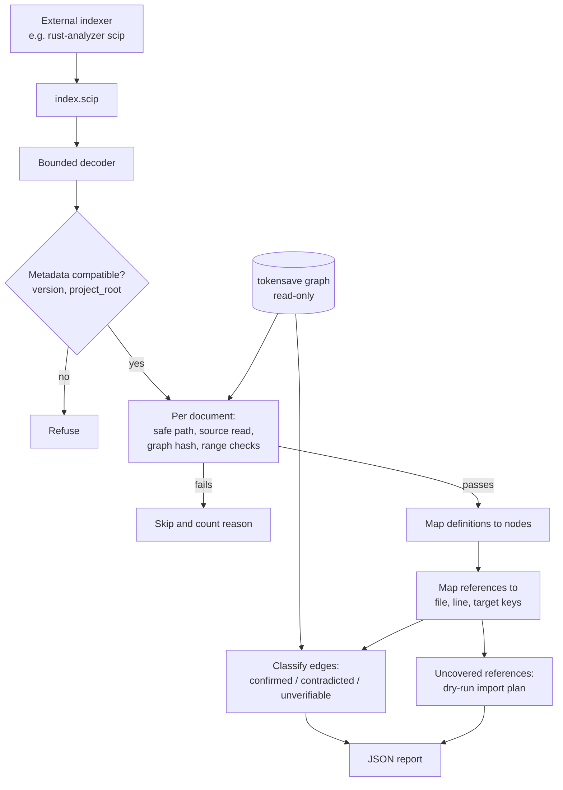

# SCIP interoperability evaluation

Research and prototype for
[#1100](https://github.com/aovestdipaperino/tokensave/issues/1100): can a
[SCIP](https://github.com/sourcegraph/scip) index from a compiler-backed
indexer improve tokensave's symbol resolution without replacing tree-sitter or
making external tools mandatory?

**Recommendation:** proceed, but only as an optional, read-only **verifier and
gap-filler**. SCIP should not become a second source of graph truth yet. On
two real crates the prototype found that 27–35 % of the resolver edges SCIP
could judge were wrong. Those errors were concentrated in the scored and
blocklist fallbacks. It also found that half of call-syntax references had no
edge. Comparison takes under 0.1 s, but producing the index took 21–69 s and
more than 1 GiB of memory. Writing SCIP edges into the graph needs the follow-up work listed
under [Recommendation](#recommendation) first. The prototype
does not claim compiler-level correctness for any construct the external
indexer does not cover.

## What was built

`tokensave scip-compare --index <file.scip> [--rebase-root] [--project P]` is
an experimental command that:

1. decodes the index with a bounded, hand-written protobuf reader
   ([src/scip/wire.rs](../../src/scip/wire.rs)), adding no dependency;
2. parses SCIP symbol strings ([src/scip/symbol.rs](../../src/scip/symbol.rs));
3. verifies each SCIP document against the current source and the tokensave
   graph, maps it onto graph nodes and edges, and prints a JSON report
   ([src/scip/compare.rs](../../src/scip/compare.rs)).

It opens the graph exactly as `graphify-export` does: read-only, after the
channel/schema preflight, inside one read transaction. It runs no sync, no
migration and no write, and makes no network call. No MCP tool, query, or
edge contract changes.



## Format mapping

| SCIP | tokensave | Notes |
|---|---|---|
| `Index.metadata.version` | — | Only `0` (`UnspecifiedProtocolVersion`) exists; anything else is refused. |
| `Index.metadata.project_root` | project root | Must be a `file://` URI naming the canonical project root. Otherwise `--rebase-root` is required. |
| `Index.metadata.tool_info` | report provenance | Name and version are kept. Arguments are never read, because they may hold local paths. |
| `Index.metadata.text_document_encoding` | — | Reported only. Sources are read as UTF-8, matching indexing. |
| `Document.relative_path` | `files.path`, `nodes.file_path` | Must be a relative path with only normal components, using `/`, and must resolve inside the root. |
| `Document.position_encoding` | — | UTF-8, UTF-16 and UTF-32 offsets are supported. Unspecified is treated as UTF-8, and unknown values skip the document. |
| `Document.text` | — | Ignored and never retained. The current file on disk is used. |
| `Occurrence.range` | `nodes.start_line..end_line`, `edges.line` | Both are **zero-based** lines. Three- and four-element forms are accepted. |
| `Occurrence` with `Definition` role | node | Same file and name as the symbol's primary descriptor, with a line span that contains the definition. The narrowest such node wins. |
| `Occurrence` without `Definition` | `(file, line, target)` reference key | The target is the node mapped from the symbol's definition. The source is the narrowest enclosing node, kept for display only. |
| `Occurrence` with `Import` role | `use` edges | Counted separately and left out of recall. |
| `local N` symbols, parameters, type parameters | — | Ignored. The graph has no node for them. |
| Symbol defined outside the project | — | Not mapped. A graph edge on the same line to a same-named project node is reported as *contradicted* (`<outside the project>`). |
| `SymbolInformation.relationships[is_implementation]` | `implements` / `extends` edge | Compared when both ends map. rust-analyzer 1.88 emits none for the fixture. |
| `SymbolInformation.documentation`, `signature_documentation`, `Diagnostic`, `enclosing_range`, `external_symbols` | — | Not decoded. External symbols are counted only. |

The primary descriptor is the last descriptor that is not a type parameter or
parameter. For rust-analyzer's
`alpha/impl#[Config][Validate]check().` it is the method `check`.

### Classification

For each graph edge, except `contains` edges and edges without a line, whose
source node lies in a verified document:

- **confirmed**: SCIP has a reference on the same file and line to the same
  target node.
- **contradicted**: SCIP has a reference on that line to a symbol with the
  target's name, but it is a different node or lies outside the project. This
  is evidence of a wrong binding (false positive).
- **unverifiable**: SCIP says nothing about that line and name. Examples are
  macro-generated code, an unmapped symbol, or a construct the indexer does
  not report.

Each SCIP reference with a mapped target and an enclosing node is a recall
candidate. One that no graph edge covers is a false negative, and becomes a
**proposed import** edge: `calls` when the reference is followed by `(` or
`::<`, otherwise `uses`. The provenance is `{origin: "scip", tool, tool_version,
symbol}`. Recall is reported overall, for call syntax, and for other references,
because tokensave deliberately does not model every type mention.

### Precedence, deduplication and invalidation (proposed for a write path)

The prototype only reports. A future import should follow these rules, which
the report already supports:

- **Precedence:** a confirmed edge keeps its existing row, and SCIP only
  upgrades its provenance. A contradicted heuristic edge (`*-scored`,
  `simple-name-match`, `same-file-blocklist`, `build-variant`) is replaced by
  the SCIP target. An exact resolver result is never replaced without review.
  An edge the extractor emitted directly is never touched.
- **Deduplication:** key on `(source, target, kind, line)`, the same key as
  today's unique edge index, and order duplicates by `Edge::provenance_rank`
  with a new exact `ResolvedBy` code for SCIP.
- **Invalidation:** SCIP has no content hash, so freshness is per document.
  The graph's `files.content_hash` must match the source, and every definition
  range must still spell its symbol's name. Sync must drop a document's SCIP
  edges whenever that file's hash changes, and keep the indexer version so a
  tool upgrade can invalidate everything.

## Stale, malformed and incompatible indexes

| Condition | Behavior |
|---|---|
| Index larger than `--max-index-mib` (default 256) | Refused before reading. |
| Truncated field, overlong varint, group wire type, field number 0, invalid UTF-8, out-of-range `int32` | Refused: `malformed SCIP index: …`. |
| More than 200k documents, 20M occurrences, 5M symbols, or a string over 64 KiB | Refused, naming the limit. |
| Protocol version other than 0 | Refused. |
| `project_root` names another directory or is not a `file://` URI | Refused unless `--rebase-root` is given. |
| Document path absolute, containing `..` or `\`, or escaping the root | Skipped: `unsafe_path`. |
| Source missing, over 16 MiB, or not UTF-8 | Skipped: `missing_source`, `source_too_large`, `source_not_utf8`. |
| File not indexed, or graph hash differs from the source | Skipped: `not_indexed_by_tokensave`, `tokensave_index_stale`. |
| Range with the wrong arity or negative values | Skipped: `malformed_range`. |
| Range past the end of the file or of a line | Skipped: `scip_stale_range_out_of_bounds`. |
| Definition range no longer spelling its name (raw `r#name` allowed) | Skipped: `scip_stale_definition_mismatch`. |
| Unknown position encoding | Skipped: `unsupported_position_encoding`. |
| Duplicate document for the same path | Only the first is used; the rest are counted. |

A skipped document never contributes to any metric. The **fallback** is
always the existing graph unchanged: tokensave keeps working standalone, and
the comparison simply covers fewer files. Unknown protobuf fields are skipped,
so newer SCIP producers stay readable.

## Fixture and reproducibility

[tests/fixtures/scip/ambiguous](../../tests/fixtures/scip/ambiguous) is a
standalone Rust crate built around name collisions:

- two `Config` types, each with `new` and a `Validate::check` impl;
- `a.check()`, `b.check()`, `c.check()` reached through local types and a
  `use alpha::Config as AlphaConfig` alias;
- two `helper` functions, with `crate::alpha::helper()` called from inside
  `beta`.

`index.scip` was produced by rust-analyzer 1.88.0 (`6b00bc3 2025-06-23`) with
`scripts/scip/regenerate.sh`. The manifest is stored as `Cargo.toml.fixture`
so that `cargo package` does not treat the fixture as a nested package and
drop it. Regenerating with the same rust-analyzer produced a byte-identical
index. The script indexes a disposable copy and
rewrites `project_root` to `file:///scip-fixture` with
`scripts/scip/normalize_index.py`, so the file has no local paths.

```text
RUST_ANALYZER="$(rustup which --toolchain 1.88 rust-analyzer)" scripts/scip/regenerate.sh
cargo test --lib scip::
cargo test --test integration scip_compare_test::
```

## Results

### Correctness on the fixture

Fixture run on 2026-11-24 against this branch:

| Metric | Value |
|---|---|
| Documents compared | 3 / 3 |
| SCIP definitions mapped to nodes | 14 / 17 (the 3 unmapped are module namespaces: `crate/`, `alpha/`, `beta/`) |
| Graph edges classified | 7: 5 confirmed, 2 contradicted, 0 unverifiable |
| Edge precision (confirmed / decided) | 0.714 |
| Recall, call-syntax references | 2 / 9 = 0.222 |
| Recall, other references | 2 / 16 = 0.125 |
| Proposed import edges | 20 (7 `calls`, 13 `uses`) |

The two contradictions are real resolver errors, and both come from the
scored fallbacks:

| Site | tokensave (`resolved_by`) | SCIP |
|---|---|---|
| `beta.rs:15` `crate::alpha::helper()` | `beta::helper` (`path-tail-match-scored`) | `alpha::helper` |
| `lib.rs:15` `a.check() && b.check() && c.check()` | `Validate::check`, the trait declaration (`exact-match-scored`) | `alpha::Config::check`, `beta::Config::check` |

By resolver path, `exact-match`, `qualified-match` and `path-tail-match` were
all confirmed (1.0), while `exact-match-scored` and `path-tail-match-scored`
were both contradicted (0.0). This matches the `ResolvedBy::is_exact` split.
The seven call-syntax misses are `alpha::Config::new()`, `beta::Config::new()`,
`AlphaConfig::new()`, `b.check()`, `beta::helper()` and `alpha::helper()` in
`lib.rs`, and `crate::alpha::helper()` in `beta.rs`. The last one was bound to
the wrong function. The others stay in `unresolved_refs`.

The recorded #921 baseline
([RESOLVER-PRECISION-BASELINE.md](../RESOLVER-PRECISION-BASELINE.md)) scored
1.0 on its probes because they have no name collisions. This fixture
deliberately does.

### Cost

Measured on 2026-11-24 on Linux x86-64 with a release `lite` build of this
branch. rust-analyzer was 1.88.0. Each crate was a disposable copy of the
published crates.io source, and tokensave ran with a private `HOME`. Three repeated
compare runs were within 0.01 s of each other. The runs are reproducible with
the same steps, but their timings are machine-specific.

| Project | Rust LOC | `tokensave init` | `rust-analyzer scip` | `scip-compare` | Index size | Graph DB size |
|---|---:|---:|---:|---:|---:|---:|
| fixture | 62 | — | 6.8 s | 2.5 ms | 6.8 KB | 0.48 MB |
| serde_json 1.0.154 | 18,387 | 0.73 s | 21.0 s warm / 68.7 s cold, 1.1 GiB RSS | 0.07 s, 28 MiB RSS | 2.56 MB | 7.22 MB |
| toml_edit 0.22.27 | 11,516 | 0.64 s | 21.6 s warm / 47.1 s cold, 1.2 GiB RSS | 0.04 s, 22 MiB RSS | 1.35 MB | 5.62 MB |

"Cold" is the first rust-analyzer run on a fresh copy. "Warm" is a second run
on a new copy after cargo's dependency and build-script cache was populated.
The correctness results below were identical in both runs.

Inside `scip-compare` on serde_json, decoding took 6 ms, loading the graph
16 ms, mapping 18 ms and classification 15 ms. The cost is dominated by the
external indexer. It is about 30 times slower than a full tokensave index even
when warm, and uses more than 1 GiB of memory. That is the main argument against running it
on every sync.

Correctness on the same crates:

| Metric | serde_json | toml_edit |
|---|---:|---:|
| Documents compared | 50 / 50 | 31 / 31 |
| Definitions mapped | 1,431 / 1,625 | 940 / 991 |
| Edges confirmed / contradicted / unverifiable | 1,380 / 731 / 1,032 | 954 / 353 / 296 |
| Edge precision | 0.654 | 0.730 |
| Recall, call syntax | 0.569 (1,210 / 2,126) | 0.497 (509 / 1,025) |
| Recall, other references | 0.038 (164 / 4,348) | 0.173 (386 / 2,233) |
| Proposed import edges (`calls` / `uses`) | 4,770 (912 / 3,858) | 2,277 (513 / 1,764) |

Precision by resolver path (confirmed / decided):

| `resolved_by` | serde_json | toml_edit |
|---|---:|---:|
| `qualified-match` | 0.967 | 0.996 |
| `exact-match` | 0.885 | 0.936 |
| `path-tail-match` | 0.732 | 0.718 |
| `exact-match-scored` | 0.327 | 0.510 |
| `path-tail-match-scored` | 0.188 | 0.882 |
| `same-file-blocklist` | 0.053 | 0.071 |
| `build-variant` | 1.0 (12) | — |

The 670 and 178 extractor edges are `annotates` edges for attributes, which
SCIP does not report, so they are all unverifiable. A sample of contradictions
checked by hand were all real binding errors:

- `self.map.contains_key(key)` inside `Map::contains_key` is bound to the
  wrapper itself, which creates fake recursion. The same happens for `clear`,
  `retain` and `clone`.
- `f32::is_sign_positive(self)` inside the trait impl is bound to that impl
  instead of the inherent `f32` method (`qualified-match`).
- `buf: &mut String` is bound to the enum variant `ParserNumber::String`
  (`same-file-blocklist`).
- `V::Value` and `Self::Error` associated types are bound to project types
  named `Value` and `Error`.

**Estimated import cost.** The edge table plus its four indexes takes about
345 bytes per edge in both databases. Importing every proposed edge would add
about 1.6 MB (+22 %) to serde_json's database and 0.8 MB (+14 %) to
toml_edit's. Importing only `calls` edges would add about 0.3 MB (+4 %) and
0.2 MB (+3 %). Edge rows would grow by 143 % and 98 % for all edges, or by
27 % and 22 % for `calls` only. `tokensave_callers` and `tokensave_impact`
fan-out grows roughly with edge count. That query overhead is an estimate and
was not measured, because the prototype does not write.

## Limitations

- **One ecosystem prototyped.** Only rust-analyzer output was exercised. The
  decoder and mapping are language-neutral, but the `impl` descriptor rule and
  the call-syntax heuristic (`(` or `::<` after the reference) are tuned to
  Rust. Maintained indexers exist for TypeScript/JavaScript (`scip-typescript`),
  Python (`scip-python`), Java/Scala/Kotlin (`scip-java`), C/C++ (`scip-clang`),
  C# (`scip-dotnet`), Ruby (`scip-ruby`) and Go (`scip-go`). Each must be
  checked before it is claimed as supported, because descriptor conventions
  and range semantics differ.
- **Line-level matching.** Edges are matched on `(file, line, target)` because
  `edges` stores no column. Two references to same-named targets on one line
  can therefore be confirmed by either. The fixture's `lib.rs:15` is such a
  line.
- **Name-based definition mapping.** A SCIP definition maps only when a node
  with the same name spans its line. Fields, enum variants, closures and
  macro-generated items without a node stay unmapped.
- **No call/reference distinction.** SCIP marks reads and writes, not calls.
  The `calls`/`uses` split of the import plan is syntactic.
- **SCIP is not ground truth.** Coverage of macros, generated code,
  `cfg`-disabled code and build scripts depends on the indexer. An
  unverifiable edge is not a wrong edge.
- **Memory.** The whole index is read into memory, bounded by
  `--max-index-mib`, and decoded with the limits above. A streaming decoder
  would be needed for very large monorepos.
- **Freshness is inferred.** SCIP carries no per-document hash, so a source
  edit that leaves every definition in place on the same line and column
  cannot be detected. The graph side is hash-checked.

## Recommendation

Proceed with SCIP as an **optional verifier first, importer second**:

1. **Keep `scip-compare` as a diagnostic** and add it to the #921 harness, so
   resolver changes are measured against compiler-backed indexes on collision
   fixtures, not only on unambiguous probes.
2. **Use the evidence to target the resolver.** On real crates, precision is
   0.88 to 1.0 for `qualified-match` and `exact-match`, but 0.05 to 0.51 for
   `same-file-blocklist` and `exact-match-scored`. The recurring errors are
   self-binding of delegating wrappers (`self.map.clear()`), associated types
   (`V::Value`), and type names that collide with enum variants. On the fixture
   the gap is `Type::new()` and `module::fn()` calls left unresolved. These
   are tree-sitter-side fixes that help users without SCIP.
3. **Only then add an opt-in import**, behind a setting and per document. It
   needs a new `ResolvedBy` code (storage format, append-only), the precedence
   and invalidation rules above, and a check that `tokensave_callers`,
   `tokensave_impact` and `tokensave_rename` treat SCIP edges as exact without
   contract changes. Measure the database growth with the real row count
   before enabling it.

Do not make an external indexer a requirement, do not replace tree-sitter, and
do not import edges from documents that fail the freshness checks.
